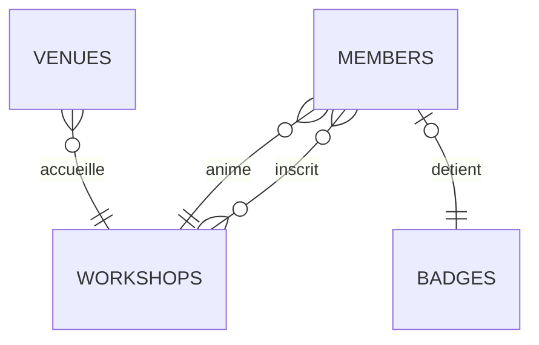
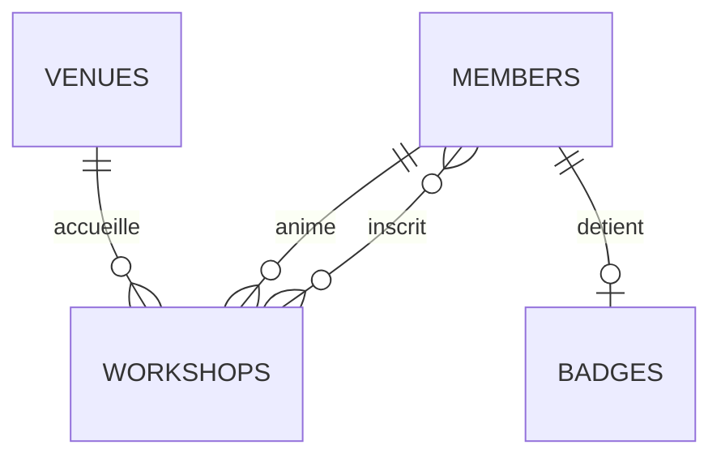
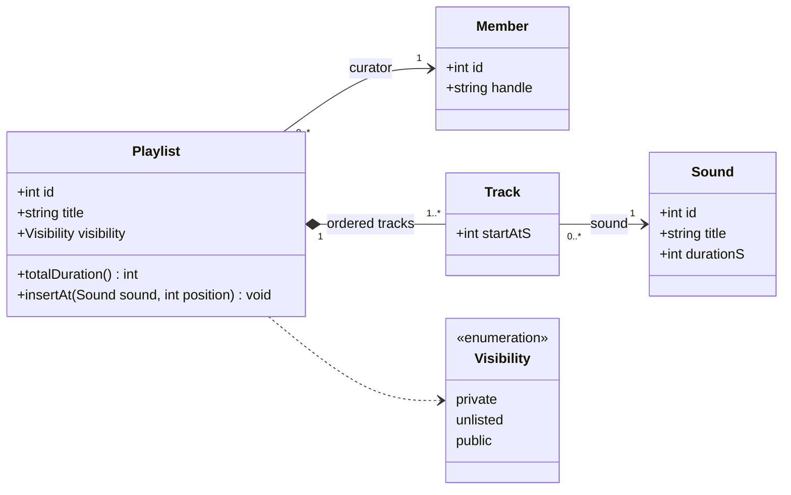
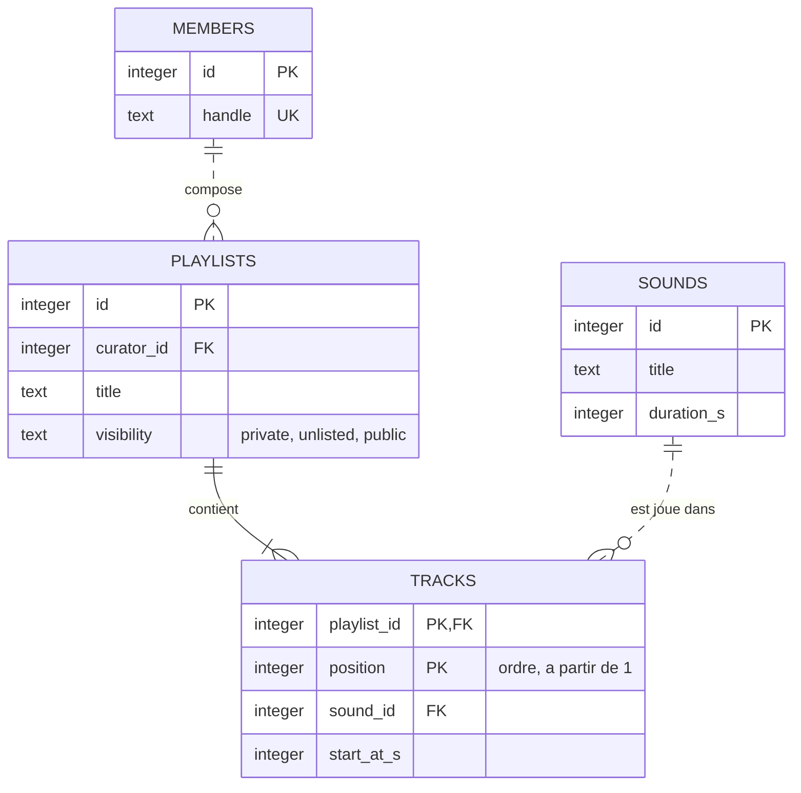

# 🥋 Katas : Modélisation — Merise, ERD, UML

Les scripts se placent dans `04-modelisation-merise-uml-erd/` et s'exécutent avec :

```bash
node --disable-warning=ExperimentalWarning kata-x.mjs
```

Ils utilisent la base du fil rouge (`../fil-rouge/open-db.mjs`) et y ajoutent leurs propres tables : rien n'est modifié sur disque, tout vit en mémoire.

**Règle commune à tous les katas : modélise d'abord sur papier (ou en texte), code ensuite.** La solution SQL n'a de valeur que si tu peux justifier chaque cardinalité.

---

## Kata 1 : Les cardinalités inversées ⭐

Un collègue a traduit ce MCD en ERD Mermaid. Le diagramme s'affiche sans erreur… et il est faux.

```text
LIEU    (0,n) ── ACCUEILLIR ── (1,1) ATELIER
MEMBRE  (0,n) ── ANIMER ────── (1,1) ATELIER
MEMBRE  (0,n) ── S'INSCRIRE ── (0,n) ATELIER        (propriété : payé)
MEMBRE  (0,1) ── DÉTENIR ───── (1,1) BADGE
```



1. Lis chaque ligne du MCD à voix haute avec la phrase-type (« un X … au minimum … au maximum … Y »).
2. Trouve les relations fausses dans le diagramme et explique l'erreur commise.
3. Écris le diagramme correct, puis les multiplicités UML de chaque association.
4. Question piège : une des relations du diagramme est juste. Pourquoi, et pourquoi est-ce de la chance ?

<details><summary>✅ Solution</summary>

**1. Lecture**
- Un lieu accueille 0 à n ateliers ; un atelier a lieu dans exactement 1 lieu.
- Un membre anime 0 à n ateliers ; un atelier est animé par exactement 1 membre.
- Un membre s'inscrit à 0 à n ateliers ; un atelier reçoit 0 à n inscriptions.
- Un membre détient au plus 1 badge ; un badge appartient à exactement 1 membre.

**2. L'erreur** : le collègue a recopié chaque cardinalité Merise **du même côté** que dans le MCD. Or en crow's foot (comme en UML), le symbole près d'une entité dit combien d'occurrences *de cette entité* correspondent à *une* occurrence d'en face. Il fallait échanger les extrémités.
- `VENUES }o--|| WORKSHOPS` se lit « un atelier a 0 à n lieux ; un lieu a exactement 1 atelier ». Faux.
- `MEMBERS }o--|| WORKSHOPS` : même inversion.
- `MEMBERS |o--|| BADGES` se lit « un badge a 0 ou 1 membre ; un membre a exactement 1 badge ». Faux dans les deux sens : un membre peut ne pas avoir de badge, un badge a forcément un détenteur.

**3. Diagramme correct**



| Association | UML |
|---|---|
| ACCUEILLIR | `Venue "1" —— "0..*" Workshop` |
| ANIMER | `Member "1" —— "0..*" Workshop` (rôle : `host`) |
| S'INSCRIRE | `Member "0..*" —— "0..*" Workshop`, avec une classe d'association `Signup { paid }` |
| DÉTENIR | `Member "1" —— "0..1" Badge` |

Remarques de rigueur :
- En Mermaid, `--` note une relation identifiante. ACCUEILLIR, ANIMER et DÉTENIR sont non identifiantes (la FK n'est pas dans la clé de l'enfant) : `..` serait plus exact.
- Mermaid accepte `}o--o{` directement, mais une n-n n'existe pas en relationnel : il faudra une table `signups` (avec `paid`). Un ERD *logique* la montrerait.
- DÉTENIR `(0,1)–(1,1)` se traduit par `badges.member_id NOT NULL UNIQUE`.

**4. Le piège** : `MEMBERS }o--o{ WORKSHOPS` est correct parce que l'association est **symétrique** : `(0,n)` des deux côtés. Échanger les extrémités ne change rien. C'est précisément ce qui rend l'erreur dangereuse : sur un diagramme mêlant symétriques et asymétriques, une partie est juste et donne confiance dans le reste.

</details>

---

## Kata 2 : Du cahier des charges au schéma Prisma ⭐⭐

L'Atelier veut gérer son matériel :

> L'Atelier possède des équipements, chacun avec un nom et un numéro de série unique. Chaque équipement appartient à une seule catégorie (audio, image…). Un membre peut emprunter un équipement : on note la date d'emprunt, la date de retour prévue, et la date de retour effective (vide tant que l'équipement n'est pas rendu). Un même membre peut emprunter plusieurs fois le même équipement à des moments différents. Un équipement ne peut évidemment pas être emprunté par deux personnes en même temps.

1. Écris le MCD (en ASCII ou dans Mocodo / Looping). Attention au mot « plusieurs fois ».
2. Déduis le MLD.
3. Écris le SQL et teste-le : deux emprunts simultanés du même équipement doivent être refusés, deux emprunts successifs acceptés.
4. Écris le schéma Prisma correspondant et liste ce qu'il ne peut pas exprimer.

<details><summary>✅ Solution</summary>

**1. MCD.** Le piège est la phrase « plusieurs fois le même équipement ». Une association MEMBRE–ÉQUIPEMENT porteuse (`date_emprunt`…) aurait pour identifiant le couple (membre, équipement), qui ne peut apparaître qu'une fois. On **réifie** l'emprunt en entité :

```text
┌────────────────┐         ╭────────────╮         ┌─────────────────────┐
│ MEMBRE         │ 0,n     │            │    1,1  │ EMPRUNT             │
├────────────────┤─────────┤ EFFECTUER  ├─────────├─────────────────────┤
│ ▸ id_membre    │         │            │         │ ▸ id_emprunt        │
│   pseudo       │         ╰────────────╯         │   date_emprunt      │
└────────────────┘                                │   date_retour_prevue│
                                                  │   date_retour       │
                                                  └──────────┬──────────┘
                                                             │ 1,1
                                                      ╭──────┴──────╮
                                                      │  CONCERNER  │
                                                      ╰──────┬──────╯
                                                             │ 0,n
┌────────────────┐         ╭────────────╮         ┌──────────┴──────────┐
│ CATÉGORIE      │ 0,n     │            │    1,1  │ ÉQUIPEMENT          │
├────────────────┤─────────┤ APPARTENIR ├─────────├─────────────────────┤
│ ▸ id_categorie │         │            │         │ ▸ id_equipement     │
│   libelle      │         ╰────────────╯         │   nom               │
└────────────────┘                                │   numero_serie      │
                                                  └─────────────────────┘
```

Alternative Merise classique : une ternaire MEMBRE–ÉQUIPEMENT–DATE avec une entité DATE. Elle est correcte mais artificielle, et l'ORM finira de toute façon par créer une classe `Loan` avec un `id`.

La règle « pas deux emprunts simultanés » n'est **pas** exprimable dans le MCD : c'est une contrainte sur l'ensemble des occurrences, à noter à côté du modèle.

**2. MLD**
- **CATÉGORIE** (<ins>id_categorie</ins>, libelle)
- **ÉQUIPEMENT** (<ins>id_equipement</ins>, nom, numero_serie, #id_categorie)
- **EMPRUNT** (<ins>id_emprunt</ins>, date_emprunt, date_retour_prevue, date_retour, #id_membre, #id_equipement)

**3. SQL testé**

```javascript
// kata-2.mjs
import { openDb } from '../fil-rouge/open-db.mjs';

const db = openDb();
db.exec(`
CREATE TABLE categories (
  id    INTEGER PRIMARY KEY,
  label TEXT    NOT NULL UNIQUE
);

CREATE TABLE equipment (
  id            INTEGER PRIMARY KEY,
  category_id   INTEGER NOT NULL REFERENCES categories (id) ON DELETE RESTRICT,
  name          TEXT    NOT NULL,
  serial_number TEXT    NOT NULL UNIQUE
);
CREATE INDEX equipment_category_id_idx ON equipment (category_id);

-- EMPRUNT réifié : le couple (membre, équipement) peut se répéter, il n'est pas la clé.
CREATE TABLE loans (
  id           INTEGER PRIMARY KEY,
  member_id    INTEGER NOT NULL REFERENCES members (id)   ON DELETE RESTRICT,
  equipment_id INTEGER NOT NULL REFERENCES equipment (id) ON DELETE RESTRICT,
  borrowed_at  TEXT    NOT NULL,
  due_at       TEXT    NOT NULL,
  returned_at  TEXT,
  CHECK (due_at >= borrowed_at),
  CHECK (returned_at IS NULL OR returned_at >= borrowed_at)
);
CREATE INDEX loans_member_id_idx    ON loans (member_id);
CREATE INDEX loans_equipment_id_idx ON loans (equipment_id);
-- « Pas deux sorties simultanées » : au plus UN prêt non rendu par équipement (index partiel).
CREATE UNIQUE INDEX loans_one_open_per_equipment ON loans (equipment_id) WHERE returned_at IS NULL;

INSERT INTO categories (id, label) VALUES (1, 'audio'), (2, 'image');
INSERT INTO equipment (id, category_id, name, serial_number) VALUES
  (1, 1, 'Enregistreur audio', 'EA-0042'),
  (2, 2, 'Appareil photo',     'AP-1337');
`);

const borrow = db.prepare('INSERT INTO loans (member_id, equipment_id, borrowed_at, due_at) VALUES (?, ?, ?, ?)');
const giveBack = db.prepare('UPDATE loans SET returned_at = ? WHERE id = ?');
const attempt = (label, fn) => {
  try { fn(); console.log(label, '→ ACCEPTÉ'); }
  catch (e) { console.log(label, '→ REFUSÉ :', e.message); }
};

attempt("theo emprunte l'enregistreur", () => borrow.run(1, 1, '2026-10-01', '2026-10-08'));
attempt('ada emprunte le même, non rendu', () => borrow.run(2, 1, '2026-10-02', '2026-10-09'));
giveBack.run('2026-10-07', 1);
attempt("ada l'emprunte après le retour", () => borrow.run(2, 1, '2026-10-10', '2026-10-17'));
giveBack.run('2026-10-15', 2);
attempt("theo l'emprunte une 2e fois", () => borrow.run(1, 1, '2026-10-20', '2026-10-27'));
attempt("retour prévu avant l'emprunt", () => borrow.run(3, 2, '2026-10-20', '2026-10-01'));
```

Sortie attendue : accepté, **refusé** (`UNIQUE constraint failed: loans.equipment_id`), accepté, accepté, **refusé** (`CHECK`).

Pourquoi un index partiel et pas un `UNIQUE (equipment_id)` simple : celui-ci interdirait tout second emprunt, même après retour. L'index partiel ne porte que sur les lignes « en cours ». SQLite et PostgreSQL le supportent ; MySQL non (il faut une colonne générée ou un déclencheur).

**4. Prisma (illustratif)**

```prisma
model Category {
  id        Int         @id @default(autoincrement())
  label     String      @unique
  equipment Equipment[]

  @@map("categories")
}

model Equipment {
  id           Int      @id @default(autoincrement())
  categoryId   Int      @map("category_id")
  category     Category @relation(fields: [categoryId], references: [id], onDelete: Restrict)
  name         String
  serialNumber String   @unique @map("serial_number")
  loans        Loan[]

  @@index([categoryId])
  @@map("equipment")
}

model Loan {
  id          Int       @id @default(autoincrement())
  memberId    Int       @map("member_id")
  equipmentId Int       @map("equipment_id")
  borrowedAt  DateTime  @map("borrowed_at") @db.Date
  dueAt       DateTime  @map("due_at") @db.Date
  returnedAt  DateTime? @map("returned_at") @db.Date
  member      Member    @relation(fields: [memberId], references: [id], onDelete: Restrict)
  equipment   Equipment @relation(fields: [equipmentId], references: [id], onDelete: Restrict)

  @@index([memberId])
  @@index([equipmentId])
  // Index partiel : en preview depuis Prisma 7.4 (previewFeatures = ["partialIndexes"]) :
  // @@unique([equipmentId], where: raw("returned_at IS NULL"))
  @@map("loans")
}
// + ajouter `loans Loan[]` dans le modèle Member (Prisma exige le champ des deux côtés).
```

Ce que le schéma Prisma n'exprime pas : les deux `CHECK` sur les dates, et l'index partiel si ta version ne le supporte pas. Ils vont dans une migration SQL écrite à la main ([module 03](../03-migrations/notes.md)). C'est normal : **le schéma de l'ORM est un sous-ensemble du schéma de la base**, jamais l'inverse.

</details>

---

## Kata 3 : Normaliser un tableur jusqu'en 3FN ⭐⭐

Voici le tableur d'inscriptions aux ateliers tel qu'il circule par mail :

| member_handle | member_email | workshop_title | workshop_date | venue_name | venue_city | fee_eur | paid |
|---|---|---|---|---|---|---|---|
| theo | theo@atelier.test | Typo et code | 2026-11-05 | La Fabrique | Lyon | 20 | 1 |
| ada | ada@atelier.test | Typo et code | 2026-11-05 | La Fabrique | Lyon | 20 | 0 |
| ada | ada@atelier.test | Son génératif | 2026-11-19 | Le Hangar | Marseille | 35 | 1 |
| bruno | bruno@atelier.test | Son génératif | 2026-11-19 | Le Hangar | Marseille | 35 | 1 |
| chloe | chloe@atelier.test | Éthique et données | 2026-12-03 | La Fabrique | Lyon | 0 | 1 |

1. Donne un exemple de chaque anomalie (mise à jour, insertion, suppression).
2. Liste les dépendances fonctionnelles et la clé de la table.
3. Normalise en 2FN puis en 3FN, en nommant la dépendance éliminée à chaque étape.
4. Écris le SQL qui crée les tables normalisées et **migre les données** du tableur.
5. Prouve que la décomposition est sans perte.

<details><summary>✅ Solution</summary>

**1. Anomalies**
- Mise à jour : « La Fabrique » déménage à Villeurbanne → trois lignes à modifier ; en oublier une crée deux villes pour le même lieu.
- Insertion : impossible d'annoncer un atelier tant que personne n'y est inscrit.
- Suppression : si chloe se désinscrit, l'atelier « Éthique et données » disparaît.

**2. DF et clé**
- `member_handle → member_email`
- `workshop_title → workshop_date, venue_name, fee_eur`
- `venue_name → venue_city`
- `(member_handle, workshop_title) → paid`

Clé : `(member_handle, workshop_title)`.

**3. Étapes**
- 1FN : déjà respectée (une valeur par cellule).
- 2FN : `member_email` dépend d'une partie de la clé (`member_handle`), `workshop_date`, `venue_name`, `fee_eur`, `venue_city` de l'autre partie (`workshop_title`) → `members (handle, email)`, `workshops (title, date, venue_name, venue_city, fee)`, `signups (member_handle, workshop_title, paid)`.
- 3FN : dans `workshops`, `title → venue_name → venue_city` est transitive → `venues (name, city)` et `workshops (title, date, venue_name, fee)`.

**4 et 5. SQL testé**

```javascript
// kata-3.mjs
import { DatabaseSync } from 'node:sqlite';

const db = new DatabaseSync(':memory:');
db.exec(`
PRAGMA foreign_keys = ON;

CREATE TABLE workshop_signups (
  member_handle TEXT, member_email TEXT,
  workshop_title TEXT, workshop_date TEXT,
  venue_name TEXT, venue_city TEXT,
  fee_eur INTEGER, paid INTEGER
);
INSERT INTO workshop_signups VALUES
  ('theo',  'theo@atelier.test',  'Typo et code',       '2026-11-05', 'La Fabrique', 'Lyon',      20, 1),
  ('ada',   'ada@atelier.test',   'Typo et code',       '2026-11-05', 'La Fabrique', 'Lyon',      20, 0),
  ('ada',   'ada@atelier.test',   'Son génératif',      '2026-11-19', 'Le Hangar',   'Marseille', 35, 1),
  ('bruno', 'bruno@atelier.test', 'Son génératif',      '2026-11-19', 'Le Hangar',   'Marseille', 35, 1),
  ('chloe', 'chloe@atelier.test', 'Éthique et données', '2026-12-03', 'La Fabrique', 'Lyon',       0, 1);

-- 3FN : une table par déterminant, clés artificielles, clés naturelles en UNIQUE.
CREATE TABLE venues (
  id   INTEGER PRIMARY KEY,
  name TEXT NOT NULL UNIQUE,
  city TEXT NOT NULL
);
CREATE TABLE members (
  id     INTEGER PRIMARY KEY,
  handle TEXT NOT NULL UNIQUE,
  email  TEXT NOT NULL UNIQUE
);
CREATE TABLE workshops (
  id       INTEGER PRIMARY KEY,
  venue_id INTEGER NOT NULL REFERENCES venues (id) ON DELETE RESTRICT,
  title    TEXT    NOT NULL UNIQUE,
  held_on  TEXT    NOT NULL,
  fee_eur  INTEGER NOT NULL CHECK (fee_eur >= 0)
);
CREATE INDEX workshops_venue_id_idx ON workshops (venue_id);
CREATE TABLE signups (
  member_id   INTEGER NOT NULL REFERENCES members (id)   ON DELETE CASCADE,
  workshop_id INTEGER NOT NULL REFERENCES workshops (id) ON DELETE CASCADE,
  paid        INTEGER NOT NULL DEFAULT 0 CHECK (paid IN (0, 1)),
  PRIMARY KEY (member_id, workshop_id)
);
CREATE INDEX signups_workshop_id_idx ON signups (workshop_id);

-- Migration des données : du déterminant le plus « haut » au plus « bas ».
INSERT INTO venues (name, city)
  SELECT DISTINCT venue_name, venue_city FROM workshop_signups;
INSERT INTO members (handle, email)
  SELECT DISTINCT member_handle, member_email FROM workshop_signups;
INSERT INTO workshops (title, held_on, fee_eur, venue_id)
  SELECT DISTINCT s.workshop_title, s.workshop_date, s.fee_eur, v.id
  FROM workshop_signups s JOIN venues v ON v.name = s.venue_name;
INSERT INTO signups (member_id, workshop_id, paid)
  SELECT m.id, w.id, s.paid
  FROM workshop_signups s
  JOIN members   m ON m.handle = s.member_handle
  JOIN workshops w ON w.title  = s.workshop_title;
`);

for (const t of ['venues', 'members', 'workshops', 'signups']) {
  console.log(t, db.prepare(`SELECT count(*) AS n FROM ${t}`).get().n);
}

// Sans perte : (tableur) EXCEPT (jointure des tables normalisées) doit être vide.
const lost = db.prepare(`
SELECT member_handle, member_email, workshop_title, workshop_date, venue_name, venue_city, fee_eur, paid
FROM workshop_signups
EXCEPT
SELECT m.handle, m.email, w.title, w.held_on, v.name, v.city, w.fee_eur, s.paid
FROM signups s
JOIN members   m ON m.id = s.member_id
JOIN workshops w ON w.id = s.workshop_id
JOIN venues    v ON v.id = w.venue_id
`).all();
console.log('lignes perdues ou altérées :', lost.length); // 0
```

Sortie : `venues 2`, `members 4`, `workshops 3`, `signups 5`, `lignes perdues ou altérées : 0`. Pour une preuve complète, vérifie aussi l'`EXCEPT` dans l'autre sens (la jointure ne doit pas produire de lignes en trop).

Points de discussion :
- Le `SELECT DISTINCT` sur `(venue_name, venue_city)` échouerait sur `UNIQUE (name)` si le tableur contenait deux villes pour « La Fabrique » : la normalisation **détecte** l'anomalie au lieu de la recopier.
- `fee_eur` dans `workshops` : c'est le tarif **actuel**. Si le tarif change et qu'on veut garder le prix payé, il faut une colonne `price_paid_eur` dans `signups`. Ce n'est pas une redondance : c'est un autre fait (le prix au moment de l'inscription).

</details>

---

## Kata 4 : Associations réflexives ⭐⭐

Deux règles nouvelles pour l'Atelier :
- **Parrainage** : chaque membre a pu être parrainé par au plus un autre membre ; un membre peut en parrainer plusieurs.
- **Mentorat** : un membre peut mentorer plusieurs membres et être mentoré par plusieurs ; on note la date de début ; on ne se mentore pas soi-même.

1. Écris les deux associations dans le MCD, avec les rôles sur les pattes.
2. Traduis-les en SQL (sur la base du fil rouge). Que se passe-t-il quand on supprime un parrain ?
3. Écris la requête « tous les membres de la lignée de mentorat de theo » (mentorés, mentorés des mentorés, etc.).
4. Que se passe-t-il si bruno mentore theo, qui mentore bruno ? Le schéma l'empêche-t-il ?
5. Écris les modèles Prisma correspondants.

<details><summary>✅ Solution</summary>

**1. MCD**

```text
            ┌───────────┐
       0,n  │           │  0,1
   parrain ─┤  MEMBRE   ├─ filleul          PARRAINER (réflexive 1-n)
            │           │
            └───────────┘

            ┌───────────┐
       0,n  │           │  0,n
    mentor ─┤  MEMBRE   ├─ mentoré          MENTORER (réflexive n-n, porteuse : depuis)
            │           │
            └───────────┘
```

Les deux pattes d'une réflexive partent de la même entité : sans les **rôles** (parrain / filleul), le modèle est ambigu. Ces rôles deviennent les noms des colonnes.

**2 à 4. SQL testé**

```javascript
// kata-4.mjs
import { openDb } from '../fil-rouge/open-db.mjs';

const db = openDb();
const attempt = (label, fn) => {
  try { fn(); console.log(label, '→ ACCEPTÉ'); }
  catch (e) { console.log(label, '→ REFUSÉ :', e.message); }
};

db.exec(`
-- PARRAINER : le côté (0,1) reçoit la clé étrangère, vers sa propre table.
ALTER TABLE members ADD COLUMN sponsor_id INTEGER REFERENCES members (id) ON DELETE SET NULL;

-- MENTORER : table d'association, deux clés étrangères nommées par rôle.
CREATE TABLE mentorships (
  mentor_id INTEGER NOT NULL REFERENCES members (id) ON DELETE CASCADE,
  mentee_id INTEGER NOT NULL REFERENCES members (id) ON DELETE CASCADE,
  since     TEXT    NOT NULL,
  PRIMARY KEY (mentor_id, mentee_id),
  CHECK (mentor_id <> mentee_id)
);
CREATE INDEX mentorships_mentee_id_idx ON mentorships (mentee_id);

UPDATE members SET sponsor_id = 1 WHERE handle IN ('ada', 'bruno');
UPDATE members SET sponsor_id = 2 WHERE handle = 'chloe';
INSERT INTO mentorships (mentor_id, mentee_id, since) VALUES
  (1, 2, '2026-02-15'),   -- theo  → ada
  (2, 4, '2026-04-10'),   -- ada   → chloe
  (1, 3, '2026-03-20'),   -- theo  → bruno
  (4, 3, '2026-05-01');   -- chloe → bruno
`);

attempt('theo se mentore lui-même', () =>
  db.prepare(`INSERT INTO mentorships VALUES (1, 1, '2026-06-01')`).run());

console.log('Filleuls de theo :', db.prepare(`
SELECT f.handle FROM members f JOIN members p ON p.id = f.sponsor_id
WHERE p.handle = 'theo' ORDER BY f.handle`).all().map((r) => r.handle));

const lineage = db.prepare(`
WITH RECURSIVE lineage (member_id, depth) AS (
  SELECT mentee_id, 1 FROM mentorships WHERE mentor_id = :root
  UNION
  SELECT m.mentee_id, l.depth + 1
  FROM mentorships m JOIN lineage l ON m.mentor_id = l.member_id
  WHERE l.depth < 10              -- garde-fou contre les cycles
)
SELECT mb.handle, min(depth) AS depth
FROM lineage JOIN members mb ON mb.id = lineage.member_id
GROUP BY mb.handle ORDER BY depth, mb.handle`);
console.log('Lignée de theo :', lineage.all({ root: 1 }).map((r) => `${r.handle}@${r.depth}`));

attempt('bruno mentore theo (cycle)', () =>
  db.prepare(`INSERT INTO mentorships VALUES (3, 1, '2026-07-01')`).run());
console.log('Lignée avec cycle :', lineage.all({ root: 1 }).map((r) => `${r.handle}@${r.depth}`));

// Suppression d'un parrain : SET NULL côté parrainage, CASCADE côté mentorat.
attempt('supprimer ada', () => db.exec(`DELETE FROM members WHERE handle = 'ada'`));
db.exec(`
INSERT INTO members (id, handle, email) VALUES (5, 'diane', 'diane@atelier.test');
INSERT INTO members (id, handle, email, sponsor_id) VALUES (6, 'emile', 'emile@atelier.test', 5);
INSERT INTO mentorships VALUES (5, 6, '2026-09-01');
DELETE FROM members WHERE handle = 'diane';
`);
console.log("Sponsor d'emile après suppression de diane :",
  db.prepare(`SELECT sponsor_id FROM members WHERE handle = 'emile'`).get().sponsor_id);
```

Sortie :
```text
theo se mentore lui-même → REFUSÉ : CHECK constraint failed: mentor_id <> mentee_id
Filleuls de theo : [ 'ada', 'bruno' ]
Lignée de theo : [ 'ada@1', 'bruno@1', 'chloe@2' ]
bruno mentore theo (cycle) → ACCEPTÉ
Lignée avec cycle : [ 'ada@1', 'bruno@1', 'chloe@2', 'theo@2' ]
supprimer ada → REFUSÉ : FOREIGN KEY constraint failed
Sponsor d'emile après suppression de diane : null
```

Ce qu'il faut remarquer :
- **Supprimer ada est refusé**, non pas à cause du parrainage (`SET NULL`) ni du mentorat (`CASCADE`), mais parce qu'elle possède un projet (`projects.owner_id ... ON DELETE RESTRICT`). Les politiques de suppression se combinent : la plus restrictive gagne.
- **Le cycle est accepté.** Aucune contrainte déclarative (`CHECK`, FK, `UNIQUE`) ne sait interdire un cycle dans un graphe : il faudrait un déclencheur qui parcourt le graphe, ou une vérification applicative. Le `CHECK (mentor_id <> mentee_id)` n'interdit que le cycle de longueur 1.
- **La CTE termine grâce au garde-fou `depth < 10`**, pas grâce à `UNION` : comme `depth` change à chaque tour, les lignes ne sont jamais identiques. Sans colonne `depth`, `UNION` seul suffirait à stopper la récursion sur un cycle.

**5. Prisma (illustratif)**

```prisma
model Member {
  id         Int          @id @default(autoincrement())
  // … champs existants …
  sponsorId  Int?         @map("sponsor_id")
  sponsor    Member?      @relation("Sponsorship", fields: [sponsorId], references: [id], onDelete: SetNull)
  sponsored  Member[]     @relation("Sponsorship")
  mentoring  Mentorship[] @relation("MentorSide")
  mentoredBy Mentorship[] @relation("MenteeSide")
}

model Mentorship {
  mentorId Int      @map("mentor_id")
  menteeId Int      @map("mentee_id")
  since    DateTime @db.Date
  mentor   Member   @relation("MentorSide", fields: [mentorId], references: [id], onDelete: Cascade)
  mentee   Member   @relation("MenteeSide", fields: [menteeId], references: [id], onDelete: Cascade)

  @@id([mentorId, menteeId])
  @@index([menteeId])
  @@map("mentorships")
}
```

Les noms de relation (`"Sponsorship"`, `"MentorSide"`, `"MenteeSide"`) sont **obligatoires** : deux relations entre les mêmes modèles sont ambiguës sans eux. C'est exactement le rôle Merise sur la patte. Le `CHECK (mentor_id <> mentee_id)` n'a pas d'équivalent Prisma : il va dans la migration.

</details>

---

## Kata 5 : Faire évoluer une hiérarchie d'héritage ⭐⭐⭐

Pars des trois stratégies des [notes](notes.md#-héritage--spécialisation-généralisation-et-trois-stratégies-de-mapping) (médias : image, vidéo, son).

1. Ajoute un sous-type `document` (champ obligatoire `page_count > 0`) dans chacune des trois stratégies. Pour chacune, liste les modifications de schéma **et** de requêtes existantes nécessaires.
2. Écris, pour chacune, la requête « durée totale des médias temporels (vidéos et sons), par projet ».
3. Conclusion : quelle stratégie absorbe le mieux l'ajout d'un sous-type ? Laquelle répond le mieux à la question 2 ?

Indice : remplacer le `CHECK (kind IN (...))` par une **table de référence** `media_kinds` change la réponse à la question 1.

<details><summary>✅ Solution</summary>

```javascript
// kata-5.mjs
import { openDb } from '../fil-rouge/open-db.mjs';

const show = (label, db, sql) => console.log(label, db.prepare(sql).all());

// ---------- Single Table ----------
{
  const db = openDb();
  db.exec(`
CREATE TABLE media_kinds (kind TEXT PRIMARY KEY);
INSERT INTO media_kinds VALUES ('image'), ('video'), ('sound');

CREATE TABLE media (
  id         INTEGER PRIMARY KEY,
  project_id INTEGER NOT NULL REFERENCES projects (id) ON DELETE CASCADE,
  kind       TEXT    NOT NULL REFERENCES media_kinds (kind),
  title      TEXT    NOT NULL,
  url        TEXT    NOT NULL,
  width INTEGER, height INTEGER, alt_text TEXT,
  duration_s INTEGER, subtitles_url TEXT, transcript TEXT,
  CHECK (kind <> 'image' OR (width IS NOT NULL AND height IS NOT NULL AND alt_text IS NOT NULL)),
  CHECK (kind NOT IN ('video', 'sound') OR duration_s IS NOT NULL)
);
INSERT INTO media (project_id, kind, title, url, width, height, alt_text) VALUES (3, 'image', 'Capture', '/a.png', 800, 600, 'Capture');
INSERT INTO media (project_id, kind, title, url, duration_s) VALUES
  (3, 'video', 'Démo', '/b.mp4', 95), (3, 'sound', 'Boucle', '/c.ogg', 12), (4, 'sound', 'Ambiance', '/d.ogg', 300);

-- Nouveau sous-type : une ligne de référence + une colonne sur la table partagée.
INSERT INTO media_kinds VALUES ('document');
ALTER TABLE media ADD COLUMN page_count INTEGER;
-- La règle « un document a un nombre de pages » ne peut pas être ajoutée en CHECK par ALTER en SQLite
-- (il faut reconstruire la table). En PostgreSQL : ALTER TABLE media ADD CONSTRAINT … CHECK (…).
INSERT INTO media (project_id, kind, title, url, page_count) VALUES (3, 'document', 'Notice', '/e.pdf', 12);
`);
  show('STI', db, `
SELECT project_id, sum(duration_s) AS total_s FROM media
WHERE kind IN ('video', 'sound')
GROUP BY project_id ORDER BY project_id`);
}

// ---------- Class Table ----------
{
  const db = openDb();
  db.exec(`
CREATE TABLE media_kinds (kind TEXT PRIMARY KEY);
INSERT INTO media_kinds VALUES ('image'), ('video'), ('sound');

CREATE TABLE media (
  id         INTEGER PRIMARY KEY,
  project_id INTEGER NOT NULL REFERENCES projects (id) ON DELETE CASCADE,
  kind       TEXT    NOT NULL REFERENCES media_kinds (kind),
  title      TEXT    NOT NULL,
  url        TEXT    NOT NULL,
  UNIQUE (id, kind)
);
CREATE TABLE images (media_id INTEGER PRIMARY KEY, kind TEXT NOT NULL DEFAULT 'image' CHECK (kind = 'image'),
  width INTEGER NOT NULL, height INTEGER NOT NULL, alt_text TEXT NOT NULL,
  FOREIGN KEY (media_id, kind) REFERENCES media (id, kind) ON DELETE CASCADE);
CREATE TABLE videos (media_id INTEGER PRIMARY KEY, kind TEXT NOT NULL DEFAULT 'video' CHECK (kind = 'video'),
  duration_s INTEGER NOT NULL, subtitles_url TEXT,
  FOREIGN KEY (media_id, kind) REFERENCES media (id, kind) ON DELETE CASCADE);
CREATE TABLE sounds (media_id INTEGER PRIMARY KEY, kind TEXT NOT NULL DEFAULT 'sound' CHECK (kind = 'sound'),
  duration_s INTEGER NOT NULL, transcript TEXT,
  FOREIGN KEY (media_id, kind) REFERENCES media (id, kind) ON DELETE CASCADE);

INSERT INTO media (id, project_id, kind, title, url) VALUES
  (1, 3, 'image', 'Capture', '/a.png'), (2, 3, 'video', 'Démo', '/b.mp4'),
  (3, 3, 'sound', 'Boucle', '/c.ogg'), (4, 4, 'sound', 'Ambiance', '/d.ogg');
INSERT INTO images (media_id, width, height, alt_text) VALUES (1, 800, 600, 'Capture');
INSERT INTO videos (media_id, duration_s) VALUES (2, 95);
INSERT INTO sounds (media_id, duration_s) VALUES (3, 12), (4, 300);

-- Nouveau sous-type : une ligne de référence + une table. Aucune table existante n'est modifiée.
INSERT INTO media_kinds VALUES ('document');
CREATE TABLE documents (media_id INTEGER PRIMARY KEY, kind TEXT NOT NULL DEFAULT 'document' CHECK (kind = 'document'),
  page_count INTEGER NOT NULL CHECK (page_count > 0),
  FOREIGN KEY (media_id, kind) REFERENCES media (id, kind) ON DELETE CASCADE);
INSERT INTO media (id, project_id, kind, title, url) VALUES (5, 3, 'document', 'Notice', '/e.pdf');
INSERT INTO documents (media_id, page_count) VALUES (5, 12);
`);
  show('CTI', db, `
SELECT m.project_id, sum(t.duration_s) AS total_s
FROM media m
JOIN (SELECT media_id, duration_s FROM videos
      UNION ALL
      SELECT media_id, duration_s FROM sounds) AS t ON t.media_id = m.id
GROUP BY m.project_id ORDER BY m.project_id`);
}

// ---------- Concrete Table ----------
{
  const db = openDb();
  db.exec(`
CREATE TABLE images (id INTEGER PRIMARY KEY, project_id INTEGER NOT NULL REFERENCES projects (id),
  title TEXT NOT NULL, url TEXT NOT NULL, width INTEGER NOT NULL, height INTEGER NOT NULL, alt_text TEXT NOT NULL);
CREATE TABLE videos (id INTEGER PRIMARY KEY, project_id INTEGER NOT NULL REFERENCES projects (id),
  title TEXT NOT NULL, url TEXT NOT NULL, duration_s INTEGER NOT NULL, subtitles_url TEXT);
CREATE TABLE sounds (id INTEGER PRIMARY KEY, project_id INTEGER NOT NULL REFERENCES projects (id),
  title TEXT NOT NULL, url TEXT NOT NULL, duration_s INTEGER NOT NULL, transcript TEXT);
INSERT INTO images (project_id, title, url, width, height, alt_text) VALUES (3, 'Capture', '/a.png', 800, 600, 'Capture');
INSERT INTO videos (project_id, title, url, duration_s) VALUES (3, 'Démo', '/b.mp4', 95);
INSERT INTO sounds (project_id, title, url, duration_s) VALUES (3, 'Boucle', '/c.ogg', 12), (4, 'Ambiance', '/d.ogg', 300);

-- Nouveau sous-type : une table autonome… et chaque requête « tous les médias » à réécrire.
CREATE TABLE documents (id INTEGER PRIMARY KEY, project_id INTEGER NOT NULL REFERENCES projects (id),
  title TEXT NOT NULL, url TEXT NOT NULL, page_count INTEGER NOT NULL CHECK (page_count > 0));
INSERT INTO documents (project_id, title, url, page_count) VALUES (3, 'Notice', '/e.pdf', 12);
`);
  show('Concrete', db, `
SELECT project_id, sum(duration_s) AS total_s
FROM (SELECT project_id, duration_s FROM videos
      UNION ALL
      SELECT project_id, duration_s FROM sounds)
GROUP BY project_id ORDER BY project_id`);
}
```

Les trois affichent `[{ project_id: 3, total_s: 107 }, { project_id: 4, total_s: 300 }]`.

**Bilan de l'ajout de `document`**

| | Schéma | Requêtes existantes |
|---|---|---|
| Single Table | `ALTER TABLE media ADD COLUMN` sur la table la plus sollicitée ; la contrainte « page_count obligatoire » demande une reconstruction de table en SQLite | aucune (sauf celles qui listent les colonnes) |
| Class Table | une table de plus | les requêtes polymorphes qui veulent les champs propres ajoutent un `LEFT JOIN documents` |
| Concrete Table | une table de plus | **toutes** les requêtes « tous les médias » (chaque `UNION ALL`) |

Sans la table `media_kinds`, Single Table et Class Table demandent en plus de modifier le `CHECK (kind IN (...))` : en SQLite, cela impose de reconstruire la table. La table de référence transforme une **migration de schéma** en simple **insertion de données**.

**Conclusion.** Class Table absorbe le mieux le nouveau sous-type. Single Table répond le plus simplement à la question 2. Une observation qui pousse plus loin : vidéo et son partagent `duration_s`. Le modèle cache une classe intermédiaire abstraite (`TimedMedia`). En Class Table, on pourrait créer une table `timed_media (media_id, duration_s)` : la requête 2 n'aurait plus besoin de `UNION ALL`. Une requête difficile signale souvent un concept manquant dans le modèle.

</details>

---

## Kata 6 : Du diagramme de classes au schéma relationnel ⭐⭐⭐

Le modèle objet d'une fonctionnalité « playlists sonores » :



Précisions : `totalDuration` est un attribut **dérivé** (UML : `/totalDuration`), les pistes sont **ordonnées** (UML : `{ordered}`), et un même son peut apparaître plusieurs fois dans une playlist.

1. Traduis ce diagramme en `erDiagram` Mermaid.
2. Écris et teste le SQL. Comment traduis-tu la composition, l'ordre, l'énumération, l'attribut dérivé ?
3. Écris l'opération `insertAt` pour un ajout en tête de playlist. Que se passe-t-il avec un `UPDATE … SET position = position + 1` naïf ?
4. Liste ce qui s'est perdu entre le diagramme de classes et le schéma, et ce qui a dû être ajouté.

<details><summary>✅ Solution</summary>

**1. ERD**



`PLAYLISTS ||--|{ TRACKS` reprend le `1..*` du diagramme, mais **aucune contrainte SQL** ne garantira qu'une playlist a au moins une piste (voir les notes, « Ce que le MLD ne sait pas dire »). Le diagramme le promet, la base ne le tient pas.

**2 et 3. SQL testé**

```javascript
// kata-6.mjs
import { openDb } from '../fil-rouge/open-db.mjs';

const db = openDb();
const attempt = (label, fn) => {
  try { fn(); console.log(label, '→ ACCEPTÉ'); }
  catch (e) { console.log(label, '→ REFUSÉ :', e.message); }
};

db.exec(`
CREATE TABLE sounds (
  id         INTEGER PRIMARY KEY,
  title      TEXT    NOT NULL,
  duration_s INTEGER NOT NULL CHECK (duration_s > 0)
);

CREATE TABLE playlists (
  id         INTEGER PRIMARY KEY,
  curator_id INTEGER NOT NULL REFERENCES members (id) ON DELETE CASCADE,
  title      TEXT    NOT NULL,
  visibility TEXT    NOT NULL DEFAULT 'private'
             CHECK (visibility IN ('private', 'unlisted', 'public'))   -- l'énumération
);
CREATE INDEX playlists_curator_id_idx ON playlists (curator_id);

-- Composition : FK NOT NULL + ON DELETE CASCADE. {ordered} : une colonne position explicite.
-- La clé est (playlist, position) et non (playlist, son) : un son peut revenir.
CREATE TABLE tracks (
  playlist_id INTEGER NOT NULL REFERENCES playlists (id) ON DELETE CASCADE,
  position    INTEGER NOT NULL CHECK (position >= 1),
  sound_id    INTEGER NOT NULL REFERENCES sounds (id) ON DELETE RESTRICT,
  start_at_s  INTEGER NOT NULL DEFAULT 0 CHECK (start_at_s >= 0),
  PRIMARY KEY (playlist_id, position)
);
CREATE INDEX tracks_sound_id_idx ON tracks (sound_id);

-- L'attribut dérivé devient une vue : jamais stocké, donc jamais désynchronisé.
CREATE VIEW playlist_durations AS
SELECT p.id AS playlist_id,
       coalesce(sum(s.duration_s - t.start_at_s), 0) AS total_duration_s
FROM playlists p
LEFT JOIN tracks t ON t.playlist_id = p.id
LEFT JOIN sounds s ON s.id = t.sound_id
GROUP BY p.id;

INSERT INTO sounds (id, title, duration_s) VALUES (1, 'Nappe', 120), (2, 'Pulsation', 60), (3, 'Souffle', 45);
INSERT INTO playlists (id, curator_id, title, visibility) VALUES (1, 4, 'Atlas : face A', 'public');
INSERT INTO tracks (playlist_id, position, sound_id, start_at_s) VALUES
  (1, 1, 1, 0), (1, 2, 2, 10), (1, 3, 1, 60);
`);

console.log(db.prepare('SELECT * FROM playlist_durations').all()); // total 230 s
attempt('visibilité inconnue', () =>
  db.prepare(`INSERT INTO playlists (curator_id, title, visibility) VALUES (1, 'x', 'secret')`).run());

// Ajout en tête : il faut décaler toutes les positions.
attempt('décalage naïf position + 1', () =>
  db.exec('UPDATE tracks SET position = position + 1 WHERE playlist_id = 1'));

// insertAt(sound, 1) : décaler hors de la plage occupée, revenir, insérer. En transaction.
function insertAtTop(playlistId, soundId) {
  db.exec('BEGIN');
  try {
    db.prepare('UPDATE tracks SET position = position + 1000000 WHERE playlist_id = ?').run(playlistId);
    db.prepare('UPDATE tracks SET position = position - 1000000 + 1 WHERE playlist_id = ?').run(playlistId);
    db.prepare('INSERT INTO tracks (playlist_id, position, sound_id) VALUES (?, 1, ?)').run(playlistId, soundId);
    db.exec('COMMIT');
  } catch (e) {
    db.exec('ROLLBACK');
    throw e;
  }
}
attempt('insertAtTop', () => insertAtTop(1, 3));
console.log(db.prepare('SELECT position, sound_id FROM tracks WHERE playlist_id = 1 ORDER BY position').all()
  .map((r) => `${r.position}:${r.sound_id}`)); // [ '1:3', '2:1', '3:2', '4:1' ]
console.log(db.prepare('SELECT * FROM playlist_durations').all()); // total 275 s
```

**Le décalage naïf est refusé** (`UNIQUE constraint failed: tracks.playlist_id, tracks.position`) : la contrainte d'unicité est vérifiée ligne par ligne, et la ligne 1 devenue 2 heurte la ligne 2 pas encore décalée. PostgreSQL se comporte de la même façon pour une contrainte non différable (sa documentation note que c'est un écart à la norme SQL, qui prévoit une vérification en fin d'instruction) ; on peut y déclarer la clé `DEFERRABLE` et la vérifier au `COMMIT`. Autres solutions : le double décalage ci-dessus (une transaction, donc invisible pour les autres), ou des positions **fractionnaires** (insérer entre 1 et 2 avec 1.5, ou des clés textuelles ordonnées) qui évitent toute renumérotation.

Note : un `CHECK (position >= 1)` interdit l'astuce classique du passage par des positions négatives ; d'où le décalage par un grand nombre.

**4. Ce qui s'est perdu / ce qui a été ajouté**

| Perdu ou approximé | Ajouté |
|---|---|
| Navigabilité (`Track → Sound` uniquement) : en SQL, on joint dans les deux sens | Clés primaires (`id`, `(playlist_id, position)`) |
| Composition : devenue `NOT NULL` + `CASCADE`, qu'on ne distingue plus d'une simple politique de suppression | Clés étrangères et leurs politiques `ON DELETE` |
| `{ordered}` : devenu une colonne `position` qu'il faut maintenir | Index sur les clés étrangères |
| `1..*` : non garanti | `CHECK` sur `duration_s`, `start_at_s`, `position` |
| `/totalDuration` : devenu une vue, hors du modèle objet | La vue `playlist_durations` |
| `insertAt` : devenu une transaction applicative | La règle « un son peut revenir », exprimée par le choix de clé |
| L'énumération en tant que type : devenue un `CHECK` sur du texte | |

Un ORM refera le chemin inverse (tables → classes) et ne retrouvera ni la composition, ni l'ordre comme concept, ni le dérivé : c'est ce que la documentation du modèle doit conserver ([module 05](../05-documenter/notes.md)).

</details>

---

**🎯 Objectif : les 6 katas, avec une justification écrite pour chaque cardinalité.**
