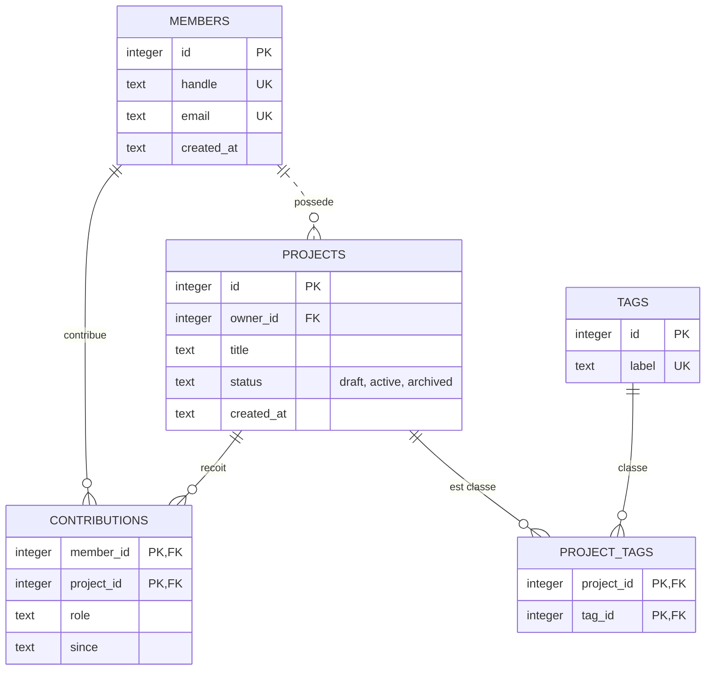
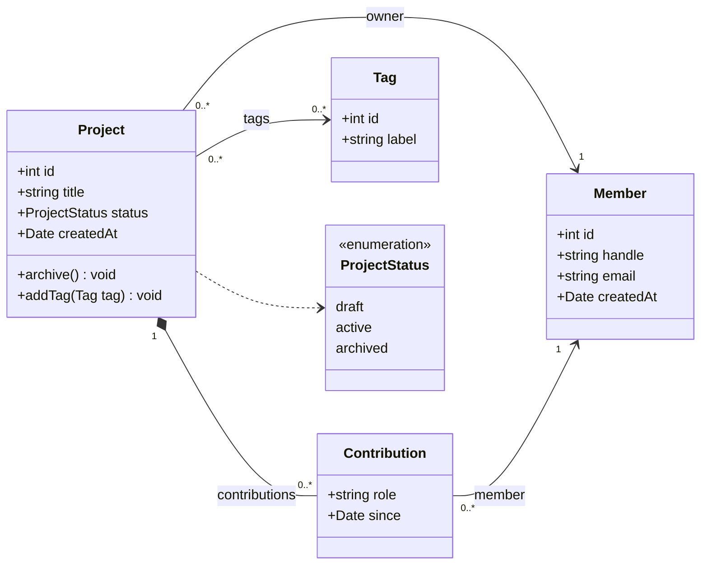

# 📐 Modélisation : Merise, ERD, UML, et ce que l'ORM en fait

## 📋 Vue d'ensemble

Un schéma d'ORM (`schema.prisma`, entités Doctrine, modèles Sequelize) est un **modèle de données écrit dans un langage de programmation**. Il hérite donc de toutes les décisions de modélisation, bonnes ou mauvaises, qu'on a prises en amont, consciemment ou pas. Ce module remonte en amont : comment on raisonne sur les données *avant* de les coder, avec trois familles de notations (Merise, ERD, UML), et comment chacune se traduit en SQL puis en ORM.

### 🎯 Objectifs

- Distinguer les niveaux conceptuel, logique et physique, et savoir à quel niveau se prend chaque décision
- Construire un MCD Merise et le traduire en MLD puis en SQL avec les règles de passage
- Normaliser une table jusqu'en 3FN (et savoir ce qu'est la BCNF) en raisonnant par dépendances fonctionnelles
- Lire et écrire un ERD (crow's foot) et un diagramme de classes UML
- **Ne jamais inverser les cardinalités** en passant de Merise à UML ou à un ERD
- Choisir une stratégie de mapping de l'héritage en connaissant son coût
- Relier chaque concept à sa forme dans un schéma d'ORM

### 🔤 Convention de nommage du module

En France, on conçoit le plus souvent en français (MCD, dictionnaire de données, échanges avec le métier) et on code en anglais (tables, colonnes, classes). Ce module suit cette convention. La correspondance pour le fil rouge :

| Conception (Merise) | Code (SQL / ORM) |
|---|---|
| MEMBRE, `id_membre`, `pseudo`, `date_inscription` | `members`, `id`, `handle`, `created_at` |
| PROJET, `titre`, `statut`, `date_creation` | `projects`, `title`, `status`, `created_at` |
| POSSÉDER (association) | `projects.owner_id` (clé étrangère) |
| CONTRIBUER (`rôle`, `depuis`) | `contributions` (`role`, `since`) |
| ÉTIQUETTE, `libelle` | `tags`, `label` |
| ÉTIQUETER (association) | `project_tags` |

Note au passage que les associations Merise sont des **verbes** (CONTRIBUER) et deviennent des **noms** en code (`contributions`, classe `Contribution`). Ce glissement verbe → nom s'appelle la *réification* : on transforme une relation en chose. Un ORM le fait systématiquement, et c'est la source de beaucoup de malentendus entre modèle conceptuel et modèle objet.

---

## 🤔 Pourquoi modéliser avant de coder

Avec un ORM *code-first*, on peut écrire des classes et laisser l'outil générer les tables. C'est rapide, et c'est exactement pour ça que c'est risqué. Quatre arguments pour modéliser d'abord :

1. **Les données survivent au code.** Une base vit souvent plus longtemps que l'application qui l'a créée. Elle sera relue par une autre application, un outil de BI, un script de migration, un export RGPD. Le modèle de données est l'interface la plus durable du système : il mérite plus de soin que le code qui l'utilise.
2. **Une cardinalité est une question métier.** « Un projet peut-il avoir plusieurs propriétaires ? » n'est pas une question technique. Le modèle oblige à poser ces questions explicitement, au lieu de les trancher par défaut en écrivant `owner: Member`.
3. **Le modèle objet n'est pas le modèle relationnel** (voir l'*impedance mismatch* au [module 01](../01-fondamentaux/notes.md)). Partir des classes tend à produire des schémas « objet » : héritage partout, colonnes JSON fourre-tout, contraintes manquantes parce que « l'application vérifie ».
4. **Les contraintes déclarées dans la base sont les seules garanties.** Une règle vérifiée seulement dans le code est contournée par le premier script SQL, le premier `UPDATE` en console ou la seconde application.

**Contre-point honnête.** Merise est née dans un contexte de cycles longs (fin des années 1970, à l'initiative du ministère de l'Industrie ; ouvrage de référence de Tardieu, Rochfeld et Colletti en 1983). Appliquée intégralement, elle produit des dossiers que personne ne relit. Elle est aussi essentiellement française : à l'international, on parle d'ERD et d'UML. Ce qui reste valable et précieux, c'est le **raisonnement** (entités, identifiants, cardinalités, dépendances fonctionnelles), utilisé de façon légère : un MCD de dix lignes pour une fonctionnalité, pas un classeur de deux cents pages.

---

## 🧱 Trois niveaux d'abstraction

| Niveau | Question | Merise | Indépendant de… | Exemple de décision |
|---|---|---|---|---|
| **Conceptuel** | *Quoi ?* Quelles informations, quelles règles métier | MCD | toute technologie | « un projet a exactement un propriétaire » |
| **Logique** | *Comment, dans un modèle de données ?* | MLD (relationnel : MLDR) | le SGBD précis | « `projet` porte une clé étrangère vers `membre` » |
| **Physique** | *Comment, dans ce SGBD ?* | MPD | — | « `owner_id INTEGER NOT NULL`, index, `ON DELETE RESTRICT` » |

Cette séparation fait écho à l'architecture à trois niveaux du groupe ANSI/X3/SPARC (rapport intermédiaire de 1975) : schémas **externe** (les vues de chaque utilisateur), **conceptuel** (la base entière, logiquement) et **interne** (le stockage). Le parallèle est utile mais pas exact : le « conceptuel » ANSI/SPARC correspond plutôt au niveau **logique** de Merise, et le MCD Merise se situe encore au-dessus, avant même le choix du modèle relationnel. Historiquement, un MLD Merise pouvait d'ailleurs cibler un SGBD réseau (CODASYL) et pas seulement relationnel.

Merise sépare aussi **données** et **traitements** : à côté du MCD, le MCT (modèle conceptuel des traitements) décrit les événements et opérations, et le MOT (modèle organisationnel des traitements) dit qui fait quoi, où et quand. Les extensions dites Merise/2 (années 1990) ont ajouté entre autres un niveau organisationnel pour les données. Ce module ne traite que les données. L'outil transversal est le **dictionnaire de données** : la liste de chaque information (code, libellé, type, taille, règle, élémentaire ou calculée). Sa version moderne et générée automatiquement est traitée au [module 05](../05-documenter/notes.md).

---

## 🧩 Le MCD (modèle conceptuel de données)

### Vocabulaire

- **Entité** (ou type d'entité) : une classe d'objets du domaine ayant une existence propre et un identifiant. MEMBRE, PROJET.
- **Occurrence** : un élément de l'entité. Le membre « theo ».
- **Propriété** : une information élémentaire portée par une entité ou une association. `email`, `rôle`.
- **Identifiant** : une ou plusieurs propriétés dont la valeur distingue chaque occurrence. Souligné dans la notation Merise.
- **Association** : un lien sémantique entre entités. Sa **dimension** est le nombre d'entités reliées : binaire (2), ternaire (3)… Une association **réflexive** relie une entité à elle-même (un membre mentore un membre).
- **Association porteuse** : une association qui a ses propres propriétés. `rôle` et `depuis` n'appartiennent ni au membre ni au projet, mais au *couple* (membre, projet).
- **Cardinalités** `(min, max)` : notées sur chaque patte d'association, **du côté de l'entité qu'elles décrivent**. Elles disent combien de fois *une occurrence de cette entité* participe à l'association. `min` vaut 0 ou 1, `max` vaut 1 ou n.

### Lire une cardinalité Merise

La phrase-type, à répéter jusqu'à ce qu'elle soit automatique :

> « **Un** [entité où est notée la cardinalité] [verbe] **au minimum** `min` et **au maximum** `max` [entité d'en face]. »

`MEMBRE (0,n) — POSSÉDER — (1,1) PROJET` se lit :
- côté MEMBRE : un membre possède au minimum 0 et au maximum n projets ;
- côté PROJET : un projet est possédé au minimum 1 et au maximum 1 fois, donc par exactement un membre.

### Le MCD du fil rouge

```text
┌────────────────────┐                                    ┌────────────────────┐
│ MEMBRE             │                                    │ PROJET             │
├────────────────────┤ 0,n     ╭────────────╮       1,1   ├────────────────────┤
│ ▸ id_membre        ├─────────┤  POSSÉDER  ├─────────────┤ ▸ id_projet        │
│   pseudo           │         ╰────────────╯             │   titre            │
│   email            │                                    │   statut           │
│   date_inscription │ 0,n     ╭────────────╮       0,n   │   date_creation    │
│                    ├─────────┤ CONTRIBUER ├─────────────┤                    │
└────────────────────┘         ├────────────┤             └─────────┬──────────┘
                               │ rôle       │                       │ 0,n
                               │ depuis     │                ╭──────┴──────╮
                               ╰────────────╯                │  ÉTIQUETER  │
                                                             ╰──────┬──────╯
                                                                    │ 0,n
                                                          ┌─────────┴──────────┐
                                                          │ ÉTIQUETTE          │
                                                          ├────────────────────┤
                                                          │ ▸ id_etiquette     │
                                                          │   libelle          │
                                                          └────────────────────┘

▸ = identifiant (souligné en notation Merise)
```

Chaque cardinalité est un choix métier qu'on peut contester :
- `PROJET (1,1)` sur POSSÉDER : pas de projet orphelin, pas de copropriété. Si l'Atelier veut des projets collectifs, c'est `(1,n)` et tout le schéma change.
- `PROJET (0,n)` sur CONTRIBUER : un projet peut n'avoir aucun contributeur déclaré. On aurait pu exiger `(1,n)`, mais (on le verra) **le SQL déclaratif ne sait pas garantir un minimum de 1 côté « n »**.
- `MEMBRE (0,n)` partout : un membre peut exister sans rien faire. C'est ce qui permet de l'inscrire avant qu'il contribue.

### Dépendances fonctionnelles et CIF

Une **dépendance fonctionnelle** (DF) `X → Y` signifie : deux occurrences qui ont la même valeur de `X` ont forcément la même valeur de `Y`. `id_membre → email` ; `(id_membre, id_projet) → rôle`. C'est l'outil formel derrière l'identifiant (l'identifiant détermine toutes les propriétés) et derrière la normalisation (plus bas).

Une cardinalité maximale de 1 *est* une dépendance fonctionnelle : `PROJET (1,1) POSSÉDER` dit `id_projet → id_membre_proprietaire`. Merise appelle **CIF** (contrainte d'intégrité fonctionnelle) une DF entre entités d'une association. Sur une binaire, la CIF se lit directement dans le `(x,1)`. Sur une ternaire, elle se note à part, et sa présence est un signal : l'association est probablement décomposable.

### Ternaires : les vraies et les fausses

Une association ternaire relie trois entités. Elle est **souvent mal modélisée**, dans les deux sens.

**Fausse ternaire.** « Un membre contribue à un projet avec un rôle », avec ROLE en entité. Si un membre n'a qu'un rôle par projet, on a la DF `(membre, projet) → rôle` : ce n'est pas une ternaire, c'est une binaire porteuse (le rôle est une propriété du couple, ou une FK vers ROLE depuis la table d'association). La modéliser en ternaire autorise des combinaisons que le métier interdit (deux rôles pour le même couple).

**Vraie ternaire décomposée à tort.** « Tel membre a mobilisé telle compétence (étiquette) sur tel projet. » Aucune DF : la connaissance est dans le *triplet*. La remplacer par trois binaires (membre–projet, projet–étiquette, membre–étiquette) fabrique de l'information fausse quand on recompose. Démonstration exécutable :

```javascript
// ternaire.mjs (dans 04-modelisation-merise-uml-erd/)
import { openDb } from '../fil-rouge/open-db.mjs';

const db = openDb();
db.exec(`
CREATE TABLE skill_uses (
  member_id  INTEGER NOT NULL REFERENCES members (id),
  project_id INTEGER NOT NULL REFERENCES projects (id),
  tag_id     INTEGER NOT NULL REFERENCES tags (id),
  PRIMARY KEY (member_id, project_id, tag_id)
);
INSERT INTO skill_uses VALUES
  (1, 1, 1),   -- theo, Carnet du dev, pedagogie
  (1, 3, 4),   -- theo, Synthé web,    web
  (2, 1, 4);   -- ada,  Carnet du dev, web

-- Décomposition fautive en trois binaires
CREATE TABLE mp AS SELECT DISTINCT member_id, project_id FROM skill_uses;
CREATE TABLE pt AS SELECT DISTINCT project_id, tag_id    FROM skill_uses;
CREATE TABLE mt AS SELECT DISTINCT member_id, tag_id     FROM skill_uses;
`);

console.table(db.prepare(`
SELECT m.handle, p.title, t.label,
       EXISTS (SELECT 1 FROM skill_uses s
               WHERE s.member_id = mp.member_id AND s.project_id = mp.project_id
                 AND s.tag_id = pt.tag_id) AS vrai
FROM mp
JOIN pt ON pt.project_id = mp.project_id
JOIN mt ON mt.member_id = mp.member_id AND mt.tag_id = pt.tag_id
JOIN members m ON m.id = mp.member_id
JOIN projects p ON p.id = mp.project_id
JOIN tags t ON t.id = pt.tag_id
ORDER BY m.handle, p.title, t.label`).all());
// → 4 lignes dont (theo, Carnet du dev, web) avec vrai = 0 : un fait inventé.
```

theo a fait du web (sur Synthé web), Carnet du dev implique du web (grâce à ada), theo travaille sur Carnet du dev : la recomposition en déduit que theo a fait du web sur Carnet du dev, ce qui est faux. C'est le *connection trap*, formalisé par les dépendances de jointure et la 5FN. Règle pratique : **une ternaire se justifie quand aucune DF ne relie ses pattes et qu'aucune paire ne suffit à reconstituer les triplets.**

> ⚠️ Les cardinalités d'une ternaire ne se traduisent pas mécaniquement en multiplicités UML (voir plus bas, « Le piège »). C'est une raison de plus de vérifier qu'une ternaire est vraiment nécessaire.

### Le cas de l'historique : quand le même couple se répète

« Un membre emprunte un équipement à une date. » Si le même membre peut emprunter le même équipement plusieurs fois, le couple (membre, équipement) **n'identifie plus** l'emprunt. Deux solutions Merise :
- une ternaire avec une entité DATE (dont l'identifiant est la date) : correcte mais artificielle ;
- **réifier** l'association en entité EMPRUNT, reliée en `(1,1)` au membre et à l'équipement. C'est ce que fera de toute façon l'ORM (une classe `Loan` avec un `id`). Voir le kata 2.

---

## 🔁 Du MCD au MLD : les règles de passage

| Situation dans le MCD | Traduction relationnelle |
|---|---|
| Entité | Une table. L'identifiant devient la clé primaire. |
| Binaire `(x,n) — (x,1)` (« un-à-plusieurs ») | Clé étrangère **dans la table côté `(x,1)`**, vers la table côté `(x,n)`. Si le côté `(x,1)` est `(1,1)` : `NOT NULL`. S'il est `(0,1)` : nullable. Les propriétés de l'association migrent avec la clé étrangère. |
| Binaire `(x,n) — (x,n)` (« plusieurs-à-plusieurs ») | Une table d'association dont la clé primaire est composée des deux clés étrangères. |
| Association porteuse `(x,n) — (x,n)` | Idem, et les propriétés deviennent des colonnes de la table d'association. |
| Binaire `(0,1) — (1,1)` (« un-à-un ») | Clé étrangère `NOT NULL` **et `UNIQUE`** côté `(1,1)`. Pour `(0,1) — (0,1)` : FK nullable et `UNIQUE`, côté le moins peuplé. |
| Réflexive | Comme une binaire, mais les deux clés étrangères pointent vers la même table : il faut les nommer par **rôle** (`mentor_id`, `mentee_id`). |
| Ternaire (ou plus) | Une table d'association avec les trois clés étrangères ; la clé primaire est composée de celles qui ne sont pas déterminées par une CIF. |

La règle à retenir pour la clé étrangère : **elle va du côté où le max vaut 1**, parce qu'une colonne ne contient qu'une valeur.

### Le MLD du fil rouge

Notation textuelle Merise : clé primaire soulignée, clé étrangère précédée de `#`.

- **MEMBRE** (<ins>id_membre</ins>, pseudo, email, date_inscription)
- **PROJET** (<ins>id_projet</ins>, titre, statut, date_creation, #id_membre_proprietaire)
- **CONTRIBUER** (<ins>#id_membre</ins>, <ins>#id_projet</ins>, rôle, depuis)
- **ÉTIQUETTE** (<ins>id_etiquette</ins>, libelle)
- **ÉTIQUETER** (<ins>#id_projet</ins>, <ins>#id_etiquette</ins>)

Contraintes à reporter :
- `pseudo`, `email`, `libelle` : uniques (ce sont des **clés candidates** non retenues comme clé primaire) ;
- `PROJET.#id_membre_proprietaire` : obligatoire (patte `(1,1)`).

### Ce que le MLD ne sait pas dire

- **Un minimum de 1 du côté « n ».** `PROJET (1,n) CONTRIBUER` (« tout projet a au moins un contributeur ») ne se traduit par aucune contrainte relationnelle simple : la table `contributions` peut toujours être vide pour un projet. Il faut un déclencheur, une contrainte différée, ou une garantie applicative (transaction qui crée le projet et sa première contribution ensemble). C'est une limite réelle, pas un oubli de ton schéma.
- **La politique de suppression.** Que devient un projet quand son propriétaire est supprimé ? Le MCD ne le dit pas. C'est une décision physique (`RESTRICT`, `CASCADE`, `SET NULL`) qui *devrait* remonter au métier.

---

## 🛠️ Du MLD au MPD : les décisions physiques

Le MPD du fil rouge est [`../fil-rouge/schema.sql`](../fil-rouge/schema.sql). En le relisant, on voit tout ce que le MLD ne contenait pas :

| Décision | Dans `schema.sql` | Justification |
|---|---|---|
| Clé artificielle | `id INTEGER PRIMARY KEY` plutôt que `handle` | Un pseudo peut changer ; une clé primaire ne doit pas. La clé naturelle reste protégée par `UNIQUE`. |
| Types | `TEXT` pour les dates | Limite de SQLite (pas de type date natif). En PostgreSQL : `timestamptz`. |
| Domaine de valeurs | `CHECK (status IN (...))` | Trois options : `CHECK`, type `ENUM` natif (PostgreSQL), table de référence avec FK. Le `CHECK` est simple ; la table de référence permet d'ajouter une valeur sans modifier le schéma (kata 5). |
| Suppression | `ON DELETE RESTRICT` pour le propriétaire, `CASCADE` pour les contributions | On ne perd pas un projet par accident ; une contribution n'a pas de sens sans son projet. |
| Index | sur chaque clé étrangère | Ni SQLite ni PostgreSQL n'indexent automatiquement une clé étrangère. Sans index, chaque `JOIN` ou suppression en cascade parcourt toute la table (voir [module 06](../06-concepts-avances/notes.md)). |
| Clé composée | `PRIMARY KEY (member_id, project_id)` | Garantit qu'un couple n'apparaît qu'une fois, sans colonne `id` superflue. |

**Clé naturelle ou artificielle ?** C. J. Date et d'autres défendent les clés naturelles parce qu'elles expriment l'unicité métier et évitent des jointures. En pratique, les clés artificielles dominent parce qu'elles sont stables, courtes et attendues par les ORMs. La position tenable : **clé artificielle pour l'identité technique, contrainte `UNIQUE` pour chaque clé naturelle**. Oublier le `UNIQUE` est l'erreur classique : la base accepte alors deux membres avec le même email.

---

## 🧪 Normalisation : la théorie derrière le « bon » schéma

La normalisation (Codd, 1970-1971, puis Boyce et Codd en 1974) formalise une intuition : **chaque fait doit être stocké une seule fois**. Un fait stocké deux fois finit par avoir deux valeurs.

### Les formes normales, en une phrase chacune

| Forme | Condition | Ce qu'elle élimine |
|---|---|---|
| **1FN** | Chaque attribut contient une valeur unique (pas de liste, pas de groupe répété). | `tags = 'pedagogie,web'` |
| **2FN** | 1FN, et aucun attribut non-clé ne dépend d'une **partie** seulement d'une clé composée. | `member_email` dans une table de clé (membre, projet) |
| **3FN** | 2FN, et aucun attribut non-clé ne dépend d'un autre attribut non-clé (pas de dépendance **transitive**). | `owner_email` qui dépend de `owner_handle` |
| **BCNF** | Tout déterminant d'une DF non triviale est une clé candidate. | les cas résiduels de la 3FN (plus bas) |

Nuance utile : C. J. Date soutient que la notion d'« atomicité » n'a pas de sens absolu (une date est-elle atomique ? un texte ?). La question pratique n'est pas « est-ce atomique ? » mais « ai-je besoin d'interroger ou de contraindre les éléments séparément ? ». Si oui, ils doivent être des lignes.

### Exemple : l'export tableur de l'Atelier

Imagine que l'Atelier tenait ses contributions dans un tableur. Une ligne par contribution :

| member_handle | member_email | project_title | project_status | owner_handle | owner_email | role | since | project_tags |
|---|---|---|---|---|---|---|---|---|
| ada | ada@atelier.test | Carnet du dev | active | theo | theo@atelier.test | relecture | 2026-02-10 | pedagogie,web |
| theo | theo@atelier.test | Carnet du dev | active | theo | theo@atelier.test | auteur | 2026-01-12 | pedagogie,web |
| … | | | | | | | | |

Les **anomalies** de ce format :
- **Mise à jour** : l'email de theo est écrit 7 fois sur 5 lignes (4 fois comme contributeur, 3 fois comme propriétaire). Si on en modifie une seule, la base contient deux emails pour theo : après une mise à jour partielle, `SELECT DISTINCT` renvoie deux adresses.
- **Insertion** : impossible d'enregistrer un nouveau membre tant qu'il n'a pas de contribution (ou alors avec une ligne pleine de vides).
- **Suppression** : supprimer la dernière contribution de bruno efface tout ce qu'on sait de bruno.

**Les dépendances fonctionnelles** (c'est ici que se fait le vrai travail, en interrogeant le métier) :
- `member_handle → member_email`
- `project_title → project_status, owner_handle`
- `owner_handle → owner_email`
- `(member_handle, project_title) → role, since`

**Clé** de la table plate : `(member_handle, project_title)`.

**Étapes :**
1. **1FN** : `project_tags` contient une liste → table (projet, étiquette).
2. **2FN** : `member_email` dépend de `member_handle` seul, `project_status` et `owner_handle` de `project_title` seul → tables `members (handle, email)` et `projects (title, status, owner_handle, owner_email)`. Il reste `contributions (member_handle, project_title, role, since)`.
3. **3FN** : dans `projects`, `title → owner_handle → owner_email` est transitive → `owner_email` sort. Or l'email d'un propriétaire, c'est l'email d'un membre : il est déjà dans `members`. La 3FN vient de révéler que « propriétaire » est un **rôle** joué par un membre, pas une entité à part.
4. **Clés artificielles** : on remplace `handle` et `title` par des `id` et on obtient… le `schema.sql` du fil rouge.

Le cœur de la migration des données, une fois les tables créées : chaque table normalisée se remplit par un `SELECT DISTINCT` sur son déterminant.

```sql
-- Les membres apparaissent comme contributeurs ET comme propriétaires.
INSERT INTO members (handle, email)
  SELECT member_handle, member_email FROM contributions_export
  UNION
  SELECT owner_handle, owner_email FROM contributions_export;

INSERT INTO projects (title, status, owner_id)
  SELECT DISTINCT e.project_title, e.project_status, m.id
  FROM contributions_export e JOIN members m ON m.handle = e.owner_handle;

INSERT INTO contributions (member_id, project_id, role, since)
  SELECT m.id, p.id, e.role, e.since
  FROM contributions_export e
  JOIN members  m ON m.handle = e.member_handle
  JOIN projects p ON p.title  = e.project_title;
-- (les étiquettes se découpent avec une CTE récursive sur la virgule)
```

Le point crucial à vérifier ensuite : **la jointure des tables normalisées redonne exactement la table plate**. Une décomposition qui ne vérifie pas cette propriété (*décomposition sans perte*) a détruit de l'information. Le [kata 3](katas.md) applique toute la démarche, contrôle par `EXCEPT` compris, sur une autre table plate.

> 💡 Normaliser révèle les incohérences. Si l'export contient deux emails pour theo, l'insertion dans `members (handle UNIQUE, email)` échoue : c'est une bonne nouvelle, la base refuse d'entériner une contradiction.

> ⚠️ Pour normaliser l'export, il a fallu supposer que `project_title` identifie un projet. Le vrai schéma ne l'impose pas (`title` n'est pas `UNIQUE`). C'est typique : une table plate cache ses identifiants, et la normalisation oblige à les choisir.

### Quand la 3FN ne suffit pas : la BCNF

Règle hypothétique de l'Atelier : chaque mentor n'enseigne qu'une compétence (`mentor → compétence`), et pour une compétence donnée un membre n'a qu'un mentor (`(membre, compétence) → mentor`). Table `sessions (membre, compétence, mentor)`.

- Clés candidates : `(membre, compétence)` et `(membre, mentor)`.
- `mentor → compétence` : `mentor` n'est pas une clé, mais `compétence` fait partie d'une clé candidate. La 3FN tolère ce cas ; la BCNF non.
- Décomposition BCNF : `(mentor, compétence)` + `(membre, mentor)`. Mais la DF `(membre, compétence) → mentor` ne peut plus être vérifiée par une contrainte sur une seule table : **la BCNF peut coûter la préservation des dépendances**. C'est un vrai compromis, pas une recette.

### Dénormaliser, consciemment

Dénormaliser est légitime quand c'est **une décision documentée** et non un accident :
- compteurs ou agrégats lus beaucoup plus souvent qu'écrits (`projects.contributors_count`) ;
- tables de reporting ou vues matérialisées ;
- copie historique volontaire (le prix d'un article **au moment** de la commande n'est pas une redondance : c'est un autre fait).

Le coût est toujours le même : il faut maintenir la copie synchrone (déclencheur, code applicatif, recalcul). Écris pourquoi dans un ADR ([module 05](../05-documenter/notes.md)).

---

## 🗺️ ERD : les diagrammes entité-relation

Le modèle entité-relation (*Entity-Relationship*, en français « entité-association ») vient de **Peter Chen**, « The Entity-Relationship Model — Toward a Unified View of Data » (*ACM TODS*, 1976). Le MCD Merise en est une variante. Trois notations à connaître :

| Notation | Origine | Forme | Usage aujourd'hui |
|---|---|---|---|
| **Chen** | Chen, 1976 | entités en rectangles, associations en losanges, attributs en ellipses, `1` / `N` / `M` sur les traits | enseignement, modélisation conceptuelle |
| **Crow's foot** (« patte d'oie ») | attribuée à Gordon Everest (1976), popularisée par l'*Information Engineering* | entités en rectangles avec leurs attributs, les cardinalités sont des symboles aux extrémités des traits | outils de conception, Mermaid, la plupart des ERD de projets |
| **IDEF1X** | standard FIPS 184 (1993) | variante normalisée, distingue relations identifiantes et non identifiantes | administrations, outils CASE anciens |

### Lire la patte d'oie

Chaque extrémité de trait porte deux symboles : **celui collé à l'entité est le maximum, l'autre le minimum**.

| Symbole | Mermaid (côté droit) | Lecture |
|---|---|---|
| `○┼` | `o\|` | zéro ou un |
| `┼┼` | `\|\|` | exactement un |
| `○<` | `o{` | zéro ou plusieurs |
| `┼<` | `\|{` | un ou plusieurs |

Comme en UML, le symbole placé près d'une entité dit **combien d'occurrences de cette entité** sont liées à **une** occurrence de l'autre.

### L'ERD du fil rouge



Détail de rigueur : en Mermaid, `--` (trait plein) note une relation **identifiante** (la clé étrangère fait partie de la clé primaire de l'enfant, comme `contributions.member_id`) et `..` (pointillé) une relation **non identifiante** (`projects.owner_id` n'est pas dans la clé de `projects`). Le diagramme du [README du chapitre](../README.md) applique cette distinction : seule la relation `members ··· projects` est en pointillé. Beaucoup de diagrammes utilisent `--` partout, ce qui est une simplification courante.

---

## 🧬 UML : le diagramme de classes

UML (*Unified Modeling Language*, OMG, version 2.5.1 en 2017) n'est **pas** un langage de modélisation de bases de données. Le diagramme de classes décrit des **objets en mémoire** : leur structure, leur comportement, leurs liens navigables. C'est donc le langage naturel d'un **modèle d'ORM**, et c'est justement pour ça qu'il faut savoir ce qui ne passe pas en SQL.

### Éléments

- **Classe** : nom, attributs (`+title: string`), opérations (`+archive(): void`). Visibilités `+` public, `-` privé, `#` protégé.
- **Association** : trait entre classes, avec une **multiplicité** à chaque extrémité (`1`, `0..1`, `0..*` ou `*`, `1..*`).
- **Navigabilité** : une flèche indique qu'on peut aller d'un objet à l'autre (`project.owner`). Sans flèche, la navigabilité est non spécifiée.
- **Agrégation** (losange vide) : relation tout/partie faible. La spécification UML elle-même dit que sa sémantique précise varie selon le domaine et le modélisateur : en pratique, elle n'apporte presque rien de traduisible.
- **Composition** (losange plein) : la partie appartient à **un seul** composite à la fois, et elle est détruite avec lui. Traduction relationnelle approchée : FK `NOT NULL` + `ON DELETE CASCADE` (+ `orphanRemoval` dans Doctrine ou JPA).
- **Classe d'association** : une classe rattachée par un pointillé à une association. C'est l'**association porteuse** de Merise. Mermaid ne sait pas la dessiner : on la représente réifiée, comme le fera l'ORM.
- **Généralisation** (flèche à triangle vide) : héritage. Les contraintes `{disjoint}` / `{overlapping}` et `{complete}` / `{incomplete}` précisent la hiérarchie.
- **Énumération** : `<<enumeration>>`.

### Le modèle objet du fil rouge



Les choix faits ici, qui ne sont **pas** dans le schéma SQL :
- **Navigabilité** : `Project → Member` (on lit `project.owner`), `Project → Tag` mais pas `Tag → Project`. En SQL, une clé étrangère se traverse dans les deux sens ; dans un ORM Data Mapper (Doctrine, Hibernate), on choisit quels champs de relation existent. Moins de navigabilité, c'est moins de couplage et moins de chargements accidentels. Prisma, lui, **impose** le champ de relation des deux côtés (`Tag.projects` est obligatoire dans le schéma, même s'il ne crée aucune colonne) : le choix de navigabilité s'y fait dans le code qui utilise le client, pas dans le schéma.
- **`Project → Tag` en n-n directe** : c'est la relation conceptuelle. Le schéma Prisma de référence (plus bas) la réifie en `ProjectTag`, une jointure explicite : le diagramme dit *ce que le domaine signifie*, le schéma *comment on le stocke*.
- **Composition `Project ◆— Contribution`** : une contribution n'existe pas sans son projet. Pourtant, en SQL, `contributions` est aussi supprimée en cascade quand le **membre** disparaît. UML interdit qu'une partie ait deux composites : la cascade côté membre est donc une politique physique, pas une composition. Une même clause `ON DELETE CASCADE` peut traduire deux intentions différentes.
- **`Contribution` sans `id`** : son identité est le couple (membre, projet). C'est la classe d'association, réifiée.

### Ce qui ne se traduit pas

| UML → relationnel : perdu ou à reconstruire | Relationnel → UML : absent ou mal exprimé |
|---|---|
| Opérations, comportements | Clés composées |
| Navigabilité (un sens seulement) | Index |
| Composition vs agrégation (approximée par `CASCADE`) | `CHECK`, contraintes multi-colonnes |
| `{ordered}` → il faut une colonne de position (kata 6) | Sémantique de `NULL` (trois valeurs de vérité) |
| Attribut dérivé `/total` → vue ou colonne générée | Politiques `ON DELETE` |
| Héritage → trois stratégies, aucune exacte (plus bas) | Transactions, isolation |
| Collections typées (`Set`, `Map`), attributs multivalués | Le fait qu'une jointure peut se faire sur n'importe quelle colonne |

UML 2 permet de marquer un attribut comme identifiant (`{id}`), mais c'est rarement utilisé ; un diagramme de classes ne montre en général pas les clés étrangères, puisque les objets se référencent directement.

---

## ⚠️ Le piège : l'inversion des cardinalités

C'est l'erreur la plus fréquente quand on passe d'un MCD à un ERD ou à un diagramme de classes, et elle produit un schéma faux sans aucun message d'erreur.

**Règle métier :** « un membre possède 0 à n projets ; un projet a exactement 1 propriétaire. »

```text
Merise : la cardinalité est notée du côté de l'entité QU'ELLE DÉCRIT
         (« combien de fois UNE occurrence de cette entité participe »)

    MEMBRE ──0,n──( POSSÉDER )──1,1── PROJET
           ▲                     ▲
           un membre : 0 à n     un projet : exactement 1 fois


UML : la multiplicité est notée à l'extrémité OPPOSÉE
      (« combien d'objets de CE côté pour UN objet de l'autre côté »)

    Member  1 ──────────────── 0..*  Project
            ▲                  ▲
            pour un projet :   pour un membre :
            1 membre           0..* projets


Crow's foot : même logique que UML

    MEMBERS ┼┼──────────────○<  PROJECTS
```

Le `0,n` est **à côté de MEMBRE** en Merise, le `0..*` est **à côté de Project** en UML. Pour une association binaire, la conversion est donc : **on échange les extrémités**, puis on traduit la notation.

| Merise, côté A | UML / crow's foot, côté B |
|---|---|
| `(0,1)` | `0..1` / `o\|` |
| `(1,1)` | `1` / `\|\|` |
| `(0,n)` | `0..*` / `o{` |
| `(1,n)` | `1..*` / `\|{` |

On décrit parfois cette différence par les termes *look here* (Merise : on lit la cardinalité **ici**, près de l'entité de départ) et *look across* (UML, Chen, crow's foot : on lit **en face**). La notation de Chen de 1976 est elle-même *look across* pour ses `1` et `N`.

**Moyen mnémotechnique** : en Merise, on se met *dans* l'entité et on se demande « combien de fois je participe ? ». En UML, on se met *dans* l'objet et on regarde la multiplicité **au bout de la flèche** : « combien j'en vois là-bas ? ».

**Le cas ternaire ne se convertit pas.** En UML, la multiplicité d'une extrémité d'une association n-aire porte sur les combinaisons des n-1 autres extrémités ; en Merise, la cardinalité compte les participations d'une occurrence. Ce ne sont pas les mêmes questions : pas de recette, il faut repartir des DF.

---

## 🌳 Héritage : spécialisation, généralisation, et trois stratégies de mapping

### Dans les modèles

- **Merise** (dans ses extensions) : une entité générique (MÉDIA) et des sous-types (IMAGE, VIDÉO, SON) qui héritent de son identifiant et de ses propriétés. Contraintes sur les sous-types : **exclusion** (X, une occurrence appartient à au plus un sous-type), **totalité** (T, au moins un), **partition** (XT, exactement un).
- **UML** : généralisation avec `{disjoint, complete}` (= partition), `{disjoint, incomplete}` (= exclusion seule), `{overlapping, complete}` (= totalité seule).

Le modèle relationnel n'a **pas** d'héritage. (PostgreSQL a bien un `INHERITS`, mais sa documentation prévient que les index, les contraintes d'unicité et les clés étrangères ne s'appliquent pas à la hiérarchie : à éviter pour ce besoin.) Il faut donc choisir une traduction. Martin Fowler (*PoEAA*, 2002) en nomme trois.

Exemple : un projet a des médias, qui sont des images (`width`, `height`, `alt_text`), des vidéos (`duration_s`, `subtitles_url`) ou des sons (`duration_s`, `transcript`). Tous les extraits suivants sont testés sur la base du fil rouge.

### 1. Single Table Inheritance (une table pour la hiérarchie)

```sql
CREATE TABLE media (
  id            INTEGER PRIMARY KEY,
  project_id    INTEGER NOT NULL REFERENCES projects (id) ON DELETE CASCADE,
  kind          TEXT    NOT NULL CHECK (kind IN ('image', 'video', 'sound')),  -- discriminant
  title         TEXT    NOT NULL,
  url           TEXT    NOT NULL,
  width         INTEGER,          -- image
  height        INTEGER,          -- image
  alt_text      TEXT,             -- image
  duration_s    INTEGER,          -- vidéo, son
  subtitles_url TEXT,             -- vidéo
  transcript    TEXT,             -- son
  -- Les NOT NULL « par sous-type » perdus, rétablis à la main :
  CHECK (kind <> 'image' OR (width IS NOT NULL AND height IS NOT NULL AND alt_text IS NOT NULL)),
  CHECK (kind = 'image' OR (width IS NULL AND height IS NULL AND alt_text IS NULL)),
  CHECK (kind NOT IN ('video', 'sound') OR duration_s IS NOT NULL),
  CHECK (kind IN ('video', 'sound') OR duration_s IS NULL),
  CHECK (kind = 'video' OR subtitles_url IS NULL),
  CHECK (kind = 'sound' OR transcript IS NULL)
);

-- « Tous les médias d'un projet » : aucune jointure.
SELECT id, kind, title, width, height, duration_s FROM media WHERE project_id = 3;
```

Les `CHECK` sont la partie que les ORMs ne génèrent presque jamais : sans eux, rien n'empêche une image sans texte alternatif ou un son avec une largeur.

### 2. Class Table Inheritance (une table par classe, jointure)

```sql
CREATE TABLE media (
  id         INTEGER PRIMARY KEY,
  project_id INTEGER NOT NULL REFERENCES projects (id) ON DELETE CASCADE,
  kind       TEXT    NOT NULL CHECK (kind IN ('image', 'video', 'sound')),
  title      TEXT    NOT NULL,
  url        TEXT    NOT NULL,
  UNIQUE (id, kind)                      -- cible de la clé étrangère composite
);

-- Chaque sous-table répète le discriminant, figé par un CHECK, et référence (id, kind) :
-- une ligne media de type 'video' ne peut donc pas avoir de ligne dans images (exclusion).
CREATE TABLE images (
  media_id INTEGER PRIMARY KEY,
  kind     TEXT    NOT NULL DEFAULT 'image' CHECK (kind = 'image'),
  width    INTEGER NOT NULL,
  height   INTEGER NOT NULL,
  alt_text TEXT    NOT NULL,
  FOREIGN KEY (media_id, kind) REFERENCES media (id, kind) ON DELETE CASCADE
);
-- videos et sounds : même structure avec leurs colonnes propres.

SELECT m.id, m.kind, m.title, i.width, i.height,
       coalesce(v.duration_s, s.duration_s) AS duration_s
FROM media m
LEFT JOIN images i ON i.media_id = m.id
LEFT JOIN videos v ON v.media_id = m.id
LEFT JOIN sounds s ON s.media_id = m.id
WHERE m.project_id = 3;
```

Le test montre : ajouter une ligne `images` pour une vidéo est **refusé** (exclusion garantie par la FK composite). En revanche, un média de type `image` sans ligne dans `images` est **accepté** : la totalité n'est pas garantie par des contraintes déclaratives simples (il faudrait des contraintes différées ou un déclencheur). La plupart des ORMs n'utilisent même pas l'astuce de la FK composite et ne garantissent donc pas non plus l'exclusion.

### 3. Concrete Table Inheritance (une table par classe concrète)

```sql
CREATE TABLE images (id INTEGER PRIMARY KEY, project_id INTEGER NOT NULL REFERENCES projects (id),
                     title TEXT NOT NULL, url TEXT NOT NULL,
                     width INTEGER NOT NULL, height INTEGER NOT NULL, alt_text TEXT NOT NULL);
CREATE TABLE videos (id INTEGER PRIMARY KEY, project_id INTEGER NOT NULL REFERENCES projects (id),
                     title TEXT NOT NULL, url TEXT NOT NULL,
                     duration_s INTEGER NOT NULL, subtitles_url TEXT);
CREATE TABLE sounds (id INTEGER PRIMARY KEY, project_id INTEGER NOT NULL REFERENCES projects (id),
                     title TEXT NOT NULL, url TEXT NOT NULL,
                     duration_s INTEGER NOT NULL, transcript TEXT);

SELECT 'image' AS kind, id, title, width, height, NULL AS duration_s FROM images WHERE project_id = :p
UNION ALL
SELECT 'video', id, title, NULL, NULL, duration_s FROM videos WHERE project_id = :p
UNION ALL
SELECT 'sound', id, title, NULL, NULL, duration_s FROM sounds WHERE project_id = :p;
```

Le test montre aussi le défaut le moins visible : les trois premiers médias ont **tous l'`id` 1**. Un « média n°1 » n'existe donc pas ; impossible pour une autre table (des commentaires, par exemple) de référencer « un média » par clé étrangère. Il faut des identifiants globaux (séquence partagée, UUID) et on perd quand même la FK.

### Comparaison

| Critère | Single Table | Class Table | Concrete Table |
|---|---|---|---|
| Requête polymorphe (« tous les médias ») | ✅ simple, rapide | ⚠️ jointures | ❌ `UNION ALL`, à réécrire à chaque sous-type |
| Requête sur un sous-type | ✅ `WHERE kind = …` | ⚠️ une jointure | ✅ une table |
| `NOT NULL` par sous-type | ❌ seulement via `CHECK` | ✅ | ✅ |
| Clé étrangère vers « un média » | ✅ | ✅ | ❌ |
| Exclusion des sous-types | ✅ (une seule ligne) | ⚠️ si FK composite | ⚠️ non garantie entre tables |
| Ajouter un sous-type | ⚠️ `ALTER` sur la table la plus sollicitée | ✅ une table de plus | ⚠️ une table + toutes les requêtes polymorphes |
| Colonnes vides | ❌ beaucoup | ✅ aucune | ✅ aucune |

Choix par défaut raisonnable : **Single Table** quand les sous-types diffèrent de peu de colonnes et qu'on requête surtout la hiérarchie entière ; **Class Table** quand les sous-types sont riches et que l'intégrité compte ; **Concrete Table** quand les sous-types ne sont presque jamais manipulés ensemble (et alors, est-ce vraiment un héritage ?).

### Côté ORM

| ORM | Stratégies proposées |
|---|---|
| Hibernate / JPA | `SINGLE_TABLE`, `JOINED`, `TABLE_PER_CLASS` (+ `@MappedSuperclass` sans requête polymorphe) |
| Doctrine (PHP) | `SINGLE_TABLE`, `JOINED`, *mapped superclass* |
| Entity Framework Core | TPH (par défaut), TPT, TPC |
| Django | héritage multi-table (= Class Table), classes abstraites (= Concrete), modèles *proxy* |
| Rails (Active Record) | STI (colonne `type`), *delegated types* (proche de Class Table) |
| TypeORM | Single Table, Concrete Table |
| Prisma | aucune stratégie native : sa documentation décrit comment simuler Single Table et Class Table à la main |

### Associations polymorphes : l'anti-pattern qui ressemble à un raccourci

Rails et Laravel popularisent les associations polymorphes : une table `comments` avec `commentable_type` (`'project'` ou `'member'`) et `commentable_id`.

```sql
CREATE TABLE comments_poly (
  id               INTEGER PRIMARY KEY,
  commentable_type TEXT    NOT NULL CHECK (commentable_type IN ('project', 'member')),
  commentable_id   INTEGER NOT NULL,     -- aucune clé étrangère possible : vers quelle table ?
  body             TEXT    NOT NULL
);
INSERT INTO comments_poly (commentable_type, commentable_id, body) VALUES ('project', 999, 'fantôme');
-- → accepté : le projet 999 n'existe pas.
```

Une colonne ne peut pas être clé étrangère vers deux tables. L'intégrité référentielle disparaît, les suppressions en cascade aussi, et l'ORM la simule en mémoire. Deux alternatives relationnelles :

- **Arc exclusif** : une FK nullable par cible, et un `CHECK` qui en impose exactement une.

  ```sql
  CREATE TABLE comments (
    id         INTEGER PRIMARY KEY,
    project_id INTEGER REFERENCES projects (id) ON DELETE CASCADE,
    member_id  INTEGER REFERENCES members (id)  ON DELETE CASCADE,
    body       TEXT    NOT NULL,
    CHECK ((project_id IS NOT NULL) + (member_id IS NOT NULL) = 1)  -- PostgreSQL : num_nonnulls(project_id, member_id) = 1
  );
  ```

  Testé : projet inexistant refusé, double cible refusée, cible unique acceptée.
- **Supertype commun** : une table `commentables` dont `projects` et `members` sont des sous-types (Class Table Inheritance). Plus lourd, mais extensible.

---

## 🔗 Correspondance Merise ↔ ERD ↔ UML ↔ SQL ↔ ORM

| Merise | ERD | UML | SQL | ORM (Prisma / Data Mapper) |
|---|---|---|---|---|
| Entité | Entité | Classe | Table | `model` / classe `@Entity` |
| Occurrence | Instance | Objet | Ligne | Objet hydraté |
| Propriété | Attribut | Attribut | Colonne | Champ scalaire |
| Identifiant | Clé primaire | `{id}` (rare) | `PRIMARY KEY` | `@id`, `@@id([...])` |
| — (clé candidate) | `UK` | — | `UNIQUE` | `@unique`, `@@unique` |
| Binaire `(x,n)–(x,1)` | 1-N | Association `1` / `0..*` | `FOREIGN KEY` côté N | champ relation + champ FK ; `ManyToOne` / `OneToMany` |
| Binaire `(x,n)–(x,n)` | M-N | Association `*` / `*` | Table de jointure | n-n implicite / `ManyToMany` |
| Association porteuse | Entité associative | Classe d'association | Table de jointure avec colonnes | Modèle explicite (`Contribution`) |
| `(0,1)–(1,1)` | 1-1 | Association `0..1` / `1` | FK `UNIQUE` | relation 1-1 (`@unique` sur la FK) |
| Réflexive | Relation récursive | Association réflexive avec rôles | FK vers la même table | relation nommée (`@relation("Mentoring")`) |
| Cardinalité côté entité | Symbole côté opposé | Multiplicité côté opposé | `NOT NULL`, `UNIQUE`, table de jointure | `Member` vs `Member?`, `Project[]` |
| Spécialisation (X, T, XT) | Sous-type / super-type | Généralisation `{disjoint, complete}` | STI / CTI / Concrete | `InheritanceType`, `@TableInheritance` |
| DF, CIF | — | — | Clé, `UNIQUE` | `@unique`, `@@id` |
| Domaine | Domaine | Type, `<<enumeration>>` | type, `CHECK`, `ENUM` | `enum`, type TS |

### Le fil rouge en Prisma (illustratif)

Le bloc `datasource` / `generator` est omis : sa forme dépend de la version de Prisma. On cible PostgreSQL pour pouvoir utiliser un `enum` natif.

```prisma
enum ProjectStatus {
  draft
  active
  archived
}

model Member {
  id            Int            @id @default(autoincrement())
  handle        String         @unique
  email         String         @unique
  createdAt     DateTime       @default(now()) @map("created_at")
  ownedProjects Project[]      @relation("ProjectOwner")
  contributions Contribution[]

  @@map("members")
}

model Project {
  id            Int            @id @default(autoincrement())
  ownerId       Int            @map("owner_id")
  owner         Member         @relation("ProjectOwner", fields: [ownerId], references: [id], onDelete: Restrict)
  title         String
  status        ProjectStatus  @default(draft)
  createdAt     DateTime       @default(now()) @map("created_at")
  contributions Contribution[]
  tags          ProjectTag[]

  @@index([ownerId])
  @@map("projects")
}

/// Association porteuse : n-n explicite, la clé est le couple.
model Contribution {
  memberId  Int      @map("member_id")
  projectId Int      @map("project_id")
  role      String
  since     DateTime @default(now()) @db.Date
  member    Member   @relation(fields: [memberId], references: [id], onDelete: Cascade)
  project   Project  @relation(fields: [projectId], references: [id], onDelete: Cascade)

  @@id([memberId, projectId])
  @@index([projectId])
  @@map("contributions")
}

model Tag {
  id       Int          @id @default(autoincrement())
  label    String       @unique
  projects ProjectTag[]

  @@map("tags")
}

/// n-n pure, rendue explicite pour garder la maîtrise du nom de table et pouvoir l'enrichir.
model ProjectTag {
  projectId Int     @map("project_id")
  tagId     Int     @map("tag_id")
  project   Project @relation(fields: [projectId], references: [id], onDelete: Cascade)
  tag       Tag     @relation(fields: [tagId], references: [id], onDelete: Cascade)

  @@id([projectId, tagId])
  @@index([tagId])
  @@map("project_tags")
}
```

Lecture croisée avec le MCD :
- `owner Member` (non optionnel) + `ownerId Int` = la patte `(1,1)` de PROJET sur POSSÉDER. `Member?` aurait traduit `(0,1)`.
- `ownedProjects Project[]` = la patte `(0,n)` de MEMBRE. Prisma ne sait pas exprimer `(1,n)` : un tableau peut toujours être vide.
- Le `CHECK` du statut est devenu un `enum` : ce n'est pas le même objet en base (type natif PostgreSQL), et changer ses valeurs passe par une migration (module 03).
- Ce que Prisma n'exprime pas (les `CHECK` de l'héritage, la contrainte `mentor_id <> mentee_id`, et jusqu'à récemment l'index partiel du kata 2, disponible en *preview* depuis Prisma 7.4) s'ajoute en SQL dans une migration ([module 03](../03-migrations/notes.md)).

### n-n implicite ou explicite ?

Prisma permet d'écrire `tags Tag[]` d'un côté et `projects Project[]` de l'autre sans modèle intermédiaire. Il crée alors une table de jointure **dont il fixe la forme** : nom `_ProjectToTag` (ou `_NomDeRelation` si on nomme la relation), colonnes `A` et `B` (`A` pointe vers le modèle premier dans l'ordre alphabétique). Conséquences :
- impossible d'y ajouter une colonne (date d'étiquetage, auteur…) : il faudra migrer vers une relation explicite ;
- les noms `A` / `B` sont illisibles pour quiconque interroge la base sans Prisma (BI, scripts, autre application) ;
- l'introspection (`prisma db pull`) ne reconnaît une table implicite que si elle respecte exactement cette convention.

**L'explicite s'impose dès que la jointure porte un attribut** (c'est le cas de `contributions`), et c'est un bon défaut même quand elle n'en porte pas encore, parce que la base n'appartient pas qu'à l'ORM.

### Le même mapping en Data Mapper (Doctrine, illustratif)

```php
#[ORM\Entity]
#[ORM\Table(name: 'projects')]
class Project
{
    #[ORM\Id, ORM\GeneratedValue, ORM\Column]
    private ?int $id = null;

    // Côté (1,1) : ManyToOne porte la clé étrangère, c'est le côté « propriétaire » de la relation.
    #[ORM\ManyToOne(targetEntity: Member::class, inversedBy: 'ownedProjects')]
    #[ORM\JoinColumn(name: 'owner_id', nullable: false, onDelete: 'RESTRICT')]
    private Member $owner;

    #[ORM\Column(length: 255)]
    private string $title;

    // Association porteuse réifiée : on navigue vers l'entité Contribution, pas vers Member.
    #[ORM\OneToMany(targetEntity: Contribution::class, mappedBy: 'project', orphanRemoval: true)]
    private Collection $contributions;

    #[ORM\ManyToMany(targetEntity: Tag::class)]
    #[ORM\JoinTable(name: 'project_tags')]
    private Collection $tags;
}
```

Doctrine (comme Hibernate) distingue le **côté propriétaire** (*owning side*, celui qui porte la clé étrangère ou la table de jointure) du **côté inverse** (`mappedBy`). Seules les modifications du côté propriétaire sont persistées : ajouter un projet à `$member->ownedProjects` sans renseigner `$project->owner` ne change rien en base. C'est l'*impedance mismatch* en miniature : la relation relationnelle n'a pas de sens, la relation objet en a deux, et l'ORM doit savoir lequel fait foi.

---

## 🔄 Ingénierie directe et inverse

- **Directe** (*forward engineering*) : modèle → SQL. MCD → MLD → script DDL (Looping, Mocodo), ou schéma d'ORM → migrations (`prisma migrate`, `drizzle-kit generate`). C'est le sens normal d'un nouveau projet.
- **Inverse** (*reverse engineering*, introspection) : base existante → modèle. `prisma db pull`, `drizzle-kit pull` (alias `introspect`), `kysely-codegen` pour les types. Indispensable pour reprendre une base héritée.

L'aller-retour **perd de l'information**, et c'est instructif de savoir laquelle. Une base ne contient que le niveau physique : elle ne sait pas qu'une table de jointure était une n-n « implicite », qu'une relation 1-1 représentait un héritage Class Table, qu'un `CASCADE` traduisait une composition, ni *pourquoi* une colonne est dénormalisée. L'introspection reconstruit la structure, jamais l'intention. D'où le module suivant : cette intention doit être écrite quelque part ([module 05](../05-documenter/notes.md)).

---

## 🧰 Outils

| Outil | Notation | Format | Ce qu'il apporte |
|---|---|---|---|
| **Looping** | Merise (MCD, MLD) | graphique, Windows | très utilisé dans les formations françaises ; génère le MLD et le script SQL depuis le MCD |
| **Mocodo** | Merise, et aussi UML, crow's foot Mermaid | **texte** (open source, MIT ; version en ligne) | le MCD s'écrit en texte, donc se versionne et se relit dans une revue de code ; génère MLD, SQL, dictionnaire |
| **Mermaid** | ERD crow's foot, classes UML | texte | rendu natif par GitHub et GitLab dans le Markdown ; pas de Merise, pas de classe d'association |
| **DBML** / dbdiagram.io | ERD | texte | DSL dédié aux schémas, conversion SQL ↔ DBML |
| **PlantUML** | UML complet, ERD (notation IE) | texte | plus expressif que Mermaid (classes d'association, notes), demande un rendu Java ou un serveur |
| **draw.io** (diagrams.net) | tout, librement | graphique (XML) | souple, mais aucune validation : on peut dessiner n'importe quoi |

Critère de choix justifié : pour un modèle qui **évolue avec le code**, préfère un format texte (Mocodo, Mermaid, DBML, PlantUML) : il se diffe, se relit en revue et vit dans le même dépôt que les migrations. Les outils graphiques sont meilleurs pour explorer au tableau avec le métier, et pour l'apprentissage.

---

## ⚠️ Erreurs fréquentes

1. **Inverser les cardinalités** entre Merise et UML / crow's foot. Toujours relire avec la phrase-type.
2. **Mettre la clé étrangère du mauvais côté** : elle va là où le max vaut 1.
3. **Oublier le `UNIQUE`** sur les clés naturelles quand on utilise une clé artificielle.
4. **Prendre une porteuse pour une n-n pure** (et la laisser en n-n implicite dans l'ORM) : le jour où l'attribut arrive, il faut migrer données et code.
5. **Utiliser le couple comme clé** alors que le couple peut se répéter dans le temps (emprunts, inscriptions successives).
6. **Décomposer une vraie ternaire** en binaires, ou garder en ternaire ce qu'une DF rend binaire.
7. **Croire que l'ORM garantit l'intégrité** : un `@relation` sans contrainte en base (ou une association polymorphe) ne protège que le code qui passe par l'ORM.
8. **Choisir l'héritage parce que le code a une hiérarchie de classes.** Un champ `kind` et un peu de composition suffisent souvent.

---

## 🔗 Liens avec les autres modules

- [01 Fondamentaux](../01-fondamentaux/notes.md) → l'*impedance mismatch* est exactement l'écart entre le diagramme de classes et le MLD vu ici.
- [02 SQL brut, query builder, ORM](../02-sql-query-builder-orm/notes.md) → les requêtes polymorphes de l'héritage montrent ce que chaque niveau d'abstraction cache ou expose.
- [03 Migrations](../03-migrations/notes.md) → chaque changement de modèle (ajouter un sous-type, passer une n-n implicite en explicite, changer un `enum`) devient une migration.
- [05 Documenter](../05-documenter/notes.md) → dictionnaire de données et ERD générés par introspection ; documenter l'intention que la base ne contient pas.
- [06 Concepts avancés](../06-concepts-avances/notes.md) → navigabilité et relations déterminent les chargements (N+1) ; index sur les clés étrangères.

---

## 📚 Pour aller plus loin

- **Peter Chen**, « The Entity-Relationship Model — Toward a Unified View of Data », *ACM Transactions on Database Systems*, 1(1), 1976. Court, lisible, fondateur.
- **E. F. Codd**, « A Relational Model of Data for Large Shared Data Banks », *CACM*, 1970 ; et « Further Normalization of the Data Base Relational Model », 1971 (2FN, 3FN).
- **H. Tardieu, A. Rochfeld, R. Colletti**, *La méthode Merise*, tome 1 : *Principes et outils*, Éditions d'Organisation, 1983.
- **C. J. Date**, *Database Design and Relational Theory: Normal Forms and All That Jazz*, O'Reilly, 2012. La normalisation traitée sérieusement, BCNF, 4FN, 5FN.
- **Martin Fowler**, *Patterns of Enterprise Application Architecture*, 2002 : Single Table, Class Table et Concrete Table Inheritance.
- **OMG**, *Unified Modeling Language Specification* 2.5.1, 2017 : la source pour la sémantique exacte de l'agrégation, de la composition et des multiplicités.
- **Bill Karwin**, *SQL Antipatterns*, Pragmatic Bookshelf, 2010 : chapitres sur les associations polymorphes et les attributs multivalués.

---

**Dernière mise à jour** : 2026-10-29
**Niveau de confiance** : ⭐⭐⭐⭐☆
**Prochaine révision** : après le module 05
