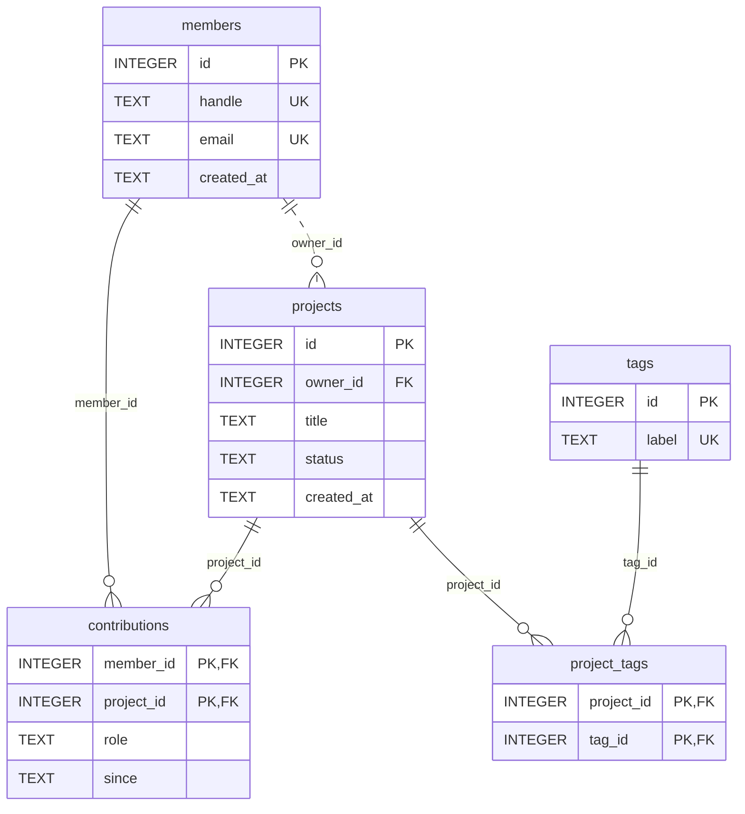

# 🥋 Katas : Documenter un ORM

## 🧰 Mise en place

Crée tes fichiers dans `05-documenter/`. Ils importent la base du fil rouge par un chemin relatif :

```javascript
import { openDb } from '../fil-rouge/open-db.mjs';
const db = openDb({ seed: false }); // schéma seul : la documentation porte sur la structure
```

```bash
node --disable-warning=ExperimentalWarning mon-fichier.mjs
```

Les katas 2, 5, 6 et 7 forment une petite chaîne d'outillage : **introspection → dictionnaire → ERD → linter → contrôle CI**. Fais-les dans l'ordre, chacun réutilise le précédent.

---

## Kata 1 : Chasser la paraphrase ⭐

Voici des descriptions trouvées dans un vrai projet. Réécris-les pour qu'elles apportent une information que le nom et le type ne donnent pas. Pour chaque phrase que tu écris, indique **d'où vient l'information** : le schéma (DDL), le code, ou le métier. Ce que tu ne peux pas vérifier, marque-le « à confirmer » au lieu de l'inventer.

| Élément | Description actuelle |
|---|---|
| `members.handle` | « Le handle du membre. » |
| `members.created_at` | « Date de création. » |
| `projects.owner_id` | « ID du propriétaire. » |
| `contributions.since` | « Depuis. » |
| `tags.label` | « Le label du tag. » |
| `project_tags` (table) | « Table de liaison projets-tags. » |

Sources à ta disposition : [`schema.sql`](../fil-rouge/schema.sql), [`seed.sql`](../fil-rouge/seed.sql), et le `ProjectRepository` du kata 4.

<details><summary>✅ Solution</summary>

| Élément | Description réécrite | Sources |
|---|---|---|
| `members.handle` | Pseudonyme public, unique, **sensible à la casse** (`Theo` et `theo` sont deux pseudonymes différents). Affiché dans l'interface : *à confirmer*. | UNIQUE et comparaison binaire : DDL. Affichage : métier. |
| `members.created_at` | Horodatage UTC de l'inscription, texte `YYYY-MM-DD HH:MM:SS`, écrit par la base. | `DEFAULT (datetime('now'))` : DDL. UTC : documentation de SQLite (`'now'` est en UTC). |
| `projects.owner_id` | Membre propriétaire, obligatoire. Supprimer un membre qui possède encore un projet est refusé (RESTRICT). À la création, le propriétaire devient aussi contributeur `auteur`. Changer de propriétaire ne met **pas** `contributions` à jour. | NOT NULL, RESTRICT : DDL. `auteur` à la création : code (`create`). Pas de mise à jour au changement : absence de code. |
| `contributions.since` | Jour de début de la contribution, `YYYY-MM-DD` en UTC, sans heure : deux contributions du même jour ne sont pas ordonnables. | `DEFAULT (date('now'))` : DDL. Conséquence : déduction. |
| `tags.label` | Libellé unique. Les données sont en minuscules sans accents : convention *à confirmer*, rien ne l'impose. | UNIQUE : DDL. Minuscules : observé dans le seed, ce qui ne prouve rien. |
| `project_tags` | Association n-n pure entre projets et étiquettes, sans donnée propre. Une ligne disparaît si le projet **ou** l'étiquette est supprimé (CASCADE des deux côtés). Archiver un projet supprime ses lignes (`ProjectRepository.archive`). | Structure, CASCADE : DDL. Archivage : code. |

Ce qu'il faut retenir : **ce qu'on observe dans les données n'est pas une garantie.** « Les libellés sont en minuscules » décrit le seed, pas une règle. Le statut d'une affirmation doit être lisible : fait vérifié, convention, ou à confirmer.

</details>

---

## Kata 2 : Générer le dictionnaire de données ⭐⭐

Écris deux modules :

1. `introspect.mjs` : `introspect(db)` renvoie, pour chaque table, ses colonnes (nom, type, nullabilité, défaut, appartenance à la clé primaire), ses clés étrangères (colonnes, table cible, actions `ON DELETE` / `ON UPDATE`) et ses index (nom, unicité, colonnes).
2. `dictionary.mjs` : `renderDictionary(schema, descriptions)` produit un Markdown avec une section par table et un tableau par colonne. Le **sens** vient d'un objet `descriptions` (SQLite n'a pas de `COMMENT ON`), la **structure** vient de l'introspection.

Contraintes :
- une description manquante est **signalée** (`⚠️ à documenter`), jamais inventée ;
- un `|` dans une description ne doit pas casser le tableau ;
- même schéma → même fichier, octet pour octet (tri stable, pas de date) ;
- les `CHECK` ne sont exposés par aucun pragma : trouve un moyen de ne pas les perdre.

Indices : `sqlite_schema` (tables et DDL d'origine), `pragma_table_info(?)`, `pragma_foreign_key_list(?)`, `pragma_index_list(?)`, `pragma_index_info(?)`. Ces pragmas s'utilisent comme des tables dans un `SELECT`.

⚠️ Piège : pour `id INTEGER PRIMARY KEY`, le pragma renvoie `notnull = 0`. Cette colonne est pourtant un alias du *rowid* et ne peut pas être `NULL`. À l'inverse, une clé primaire SQLite d'un autre type **accepte** `NULL` sans `NOT NULL` explicite (bug historique conservé pour compatibilité). C'est pour cela que les clés composites du fil rouge sont déclarées `NOT NULL`.

<details><summary>✅ Solution</summary>

````javascript
// introspect.mjs — lit la structure d'une base SQLite : tables, colonnes, clés étrangères, index.
// Ne lit que ce que la base sait d'elle-même : ni le sens des colonnes, ni les CHECK
// (qui ne restent visibles que dans le DDL d'origine, conservé dans `sql`).
export function introspect(db) {
  const tables = db
    .prepare(
      `SELECT name, sql FROM sqlite_schema
       WHERE type = 'table' AND name NOT LIKE 'sqlite_%'
       ORDER BY name`
    )
    .all();

  return tables.map(({ name, sql }) => {
    const rawColumns = db.prepare('SELECT * FROM pragma_table_info(?) ORDER BY cid').all(name);
    const pkColumns = rawColumns
      .filter((c) => c.pk > 0)
      .sort((a, b) => a.pk - b.pk)
      .map((c) => c.name);
    // `id INTEGER PRIMARY KEY` est un alias du rowid : jamais NULL, même si le pragma dit notnull = 0.
    // Toute autre clé primaire SQLite accepte NULL sans NOT NULL explicite (bug historique conservé).
    const rowidAlias =
      pkColumns.length === 1 &&
      rawColumns.find((c) => c.name === pkColumns[0]).type.toUpperCase() === 'INTEGER';

    const columns = rawColumns.map((c) => ({
      name: c.name,
      type: c.type || 'ANY',
      notNull: c.notnull === 1 || (rowidAlias && c.pk === 1),
      default: c.dflt_value,
      pk: c.pk > 0,
    }));

    const foreignKeys = groupForeignKeys(db.prepare('SELECT * FROM pragma_foreign_key_list(?)').all(name));

    const indexes = db
      .prepare('SELECT name, "unique", origin FROM pragma_index_list(?) ORDER BY name')
      .all(name)
      .map((index) => ({
        name: index.name,
        unique: index.unique === 1,
        origin: index.origin, // 'c' = CREATE INDEX, 'u' = contrainte UNIQUE, 'pk' = clé primaire
        columns: db
          .prepare('SELECT name FROM pragma_index_info(?) ORDER BY seqno')
          .all(index.name)
          .map((c) => c.name),
      }));

    return { name, sql, columns, primaryKey: pkColumns, foreignKeys, indexes };
  });
}

// Une clé étrangère composite occupe plusieurs lignes (même `id`, `seq` croissant).
function groupForeignKeys(rows) {
  const byId = new Map();
  for (const row of rows) {
    if (!byId.has(row.id)) {
      byId.set(row.id, {
        columns: [],
        table: row.table,
        references: [],
        onDelete: row.on_delete,
        onUpdate: row.on_update,
      });
    }
    const fk = byId.get(row.id);
    fk.columns[row.seq] = row.from;
    fk.references[row.seq] = row.to;
  }
  // Ordre stable : par colonnes locales, pour que la documentation générée soit déterministe.
  return [...byId.values()].sort((a, b) => a.columns.join().localeCompare(b.columns.join()));
}
````

Le sens, dans un fichier versionné qui joue le rôle des commentaires en base :

```javascript
// descriptions.mjs — la source du *sens* du schéma.
// SQLite n'a pas de COMMENT ON : ce fichier joue le rôle des commentaires en base
// (comme la section `comments:` de tbls). Il est versionné avec les migrations.
// `$table` décrit la table ; les autres clés décrivent les colonnes.
const TECH_ID =
  "Identifiant technique attribué par la base. Sans AUTOINCREMENT, SQLite peut réattribuer l'id " +
  'de la dernière ligne supprimée : ne pas en faire une référence externe durable.';
const UTC_TIMESTAMP = 'Horodatage UTC, texte ISO 8601 `YYYY-MM-DD HH:MM:SS` (convention ADR-0003).';

export const descriptions = {
  members: {
    $table: "Personne inscrite à l'Atelier. Peut posséder des projets et contribuer à d'autres.",
    id: TECH_ID,
    handle: "Pseudonyme public affiché dans l'interface. Unique, sensible à la casse (comparaison binaire SQLite).",
    email:
      'Adresse de contact et de connexion. Donnée personnelle (RGPD) : à effacer à la suppression du compte. ' +
      'Unique mais sensible à la casse : `Theo@…` et `theo@…` peuvent coexister (écart connu, non tranché).',
    created_at: `Date d'inscription. ${UTC_TIMESTAMP}`,
  },
  projects: {
    $table: "Projet porté par un membre. Un projet archivé n'apparaît plus dans les listes par défaut (ProjectRepository.findAll).",
    id: TECH_ID,
    owner_id:
      'Membre propriétaire, obligatoire. Supprimer un membre qui possède encore des projets est refusé (RESTRICT, appliqué par la base).',
    title: 'Titre affiché. Non vide et sans espaces de bord : règle appliquée par ProjectRepository.create, pas par la base.',
    status:
      'Cycle de vie : `draft` | `active` | `archived` (CHECK en base). Les transitions draft → active → archived ne sont vérifiées nulle part.',
    created_at: `Date de création. ${UTC_TIMESTAMP}`,
  },
  contributions: {
    $table: "Participation d'un membre à un projet, avec un rôle. Association n-n porteuse : table explicite (ADR-0002).",
    member_id: 'Membre contributeur. Ligne supprimée avec le membre (CASCADE).',
    project_id: 'Projet concerné. Ligne supprimée avec le projet (CASCADE).',
    role:
      'Rôle libre, sans contrainte en base. Valeurs observées : `auteur`, `dev`, `design`, `relecture`, `son`. ' +
      'Le propriétaire reçoit le rôle `auteur` à la création du projet (ProjectRepository.create).',
    since: "Jour de début de la contribution, `YYYY-MM-DD`, en UTC. Pas d'heure : deux contributions du même jour ne sont pas ordonnées.",
  },
  tags: {
    $table: 'Étiquette de classement, partagée entre projets.',
    id: TECH_ID,
    label: 'Libellé unique, en minuscules sans accents (convention éditoriale, non vérifiée par la base).',
  },
  project_tags: {
    $table: 'Association n-n pure entre projets et étiquettes : aucune donnée propre.',
    project_id: 'Projet étiqueté. Ligne supprimée avec le projet (CASCADE).',
    tag_id: "Étiquette posée. Ligne supprimée avec l'étiquette (CASCADE).",
  },
};
```

````javascript
// dictionary.mjs — génère un dictionnaire de données Markdown : structure lue dans la base,
// sens lu dans `descriptions`. Une information manquante est signalée, jamais inventée.
const TODO = '⚠️ _à documenter_';

// Dans un tableau Markdown, `|` ferme la cellule et un saut de ligne casse la ligne.
const cell = (text) => String(text).replaceAll('|', '\\|').replaceAll('\n', ' ');

// Colonne unique à elle seule (contrainte UNIQUE ou index unique sur cette seule colonne).
const isUniqueAlone = (table, column) =>
  table.indexes.some(
    (index) => index.unique && index.origin !== 'pk' && index.columns.length === 1 && index.columns[0] === column
  );

export function renderDictionary(schema, descriptions = {}) {
  const lines = ['# Dictionnaire de données', ''];

  for (const table of schema) {
    const doc = descriptions[table.name] ?? {};
    lines.push(`## \`${table.name}\``, '', `> ${doc.$table ?? TODO}`, '');
    lines.push('| Colonne | Type | Null | Défaut | Clé | Description |');
    lines.push('|---|---|---|---|---|---|');

    for (const column of table.columns) {
      const keys = [];
      if (column.pk) keys.push('PK');
      if (isUniqueAlone(table, column.name)) keys.push('UK');
      for (const fk of table.foreignKeys) {
        const i = fk.columns.indexOf(column.name);
        if (i !== -1) keys.push(`FK → \`${fk.table}.${fk.references[i]}\``);
      }
      lines.push(
        '| ' +
          [
            `\`${column.name}\``,
            column.type,
            column.notNull ? 'non' : 'oui',
            column.default === null ? '—' : `\`${column.default}\``,
            keys.join(', ') || '—',
            doc[column.name] ?? TODO,
          ]
            .map(cell)
            .join(' | ') +
          ' |'
      );
    }

    if (table.foreignKeys.length > 0) {
      lines.push('', '**Clés étrangères**', '');
      for (const fk of table.foreignKeys) {
        const from = fk.columns.map((c) => `\`${c}\``).join(', ');
        const to = fk.references.map((c) => `${fk.table}.${c}`).join(', ');
        lines.push(`- ${from} → \`${to}\` (ON DELETE ${fk.onDelete}, ON UPDATE ${fk.onUpdate})`);
      }
    }

    if (table.indexes.length > 0) {
      lines.push('', '**Index**', '');
      for (const index of table.indexes) {
        const columns = index.columns.map((c) => `\`${c}\``).join(', ');
        lines.push(`- \`${index.name}\`${index.unique ? ' UNIQUE' : ''} (${columns})`);
      }
    }

    // Les CHECK ne sont exposés par aucun pragma : on montre le DDL plutôt que de les perdre.
    lines.push('', "<details><summary>DDL d'origine</summary>", '', '```sql', table.sql, '```', '', '</details>', '');
  }

  return lines.join('\n');
}
````

```javascript
// run-dictionary.mjs — affiche le dictionnaire de données du fil rouge.
import { openDb } from '../fil-rouge/open-db.mjs';
import { introspect } from './introspect.mjs';
import { renderDictionary } from './dictionary.mjs';
import { descriptions } from './descriptions.mjs';

const schema = introspect(openDb({ seed: false }));
console.log(renderDictionary(schema, descriptions));
```

Extrait de la sortie :

````markdown
## `projects`

> Projet porté par un membre. Un projet archivé n'apparaît plus dans les listes par défaut (ProjectRepository.findAll).

| Colonne | Type | Null | Défaut | Clé | Description |
|---|---|---|---|---|---|
| `id` | INTEGER | non | — | PK | Identifiant technique attribué par la base. Sans AUTOINCREMENT, SQLite peut réattribuer l'id de la dernière ligne supprimée : ne pas en faire une référence externe durable. |
| `owner_id` | INTEGER | non | — | FK → `members.id` | Membre propriétaire, obligatoire. Supprimer un membre qui possède encore des projets est refusé (RESTRICT, appliqué par la base). |
| `title` | TEXT | non | — | — | Titre affiché. Non vide et sans espaces de bord : règle appliquée par ProjectRepository.create, pas par la base. |
| `status` | TEXT | non | `'draft'` | — | Cycle de vie : `draft` \| `active` \| `archived` (CHECK en base). Les transitions draft → active → archived ne sont vérifiées nulle part. |
| `created_at` | TEXT | non | `datetime('now')` | — | Date de création. Horodatage UTC, texte ISO 8601 `YYYY-MM-DD HH:MM:SS` (convention ADR-0003). |

**Clés étrangères**

- `owner_id` → `members.id` (ON DELETE RESTRICT, ON UPDATE NO ACTION)

**Index**

- `projects_owner_id_idx` (`owner_id`)

<details><summary>DDL d'origine</summary>

```sql
CREATE TABLE projects (
  id         INTEGER PRIMARY KEY,
  owner_id   INTEGER NOT NULL REFERENCES members (id) ON DELETE RESTRICT,
  title      TEXT    NOT NULL,
  status     TEXT    NOT NULL DEFAULT 'draft'
             CHECK (status IN ('draft', 'active', 'archived')),
  created_at TEXT    NOT NULL DEFAULT (datetime('now'))
)
```

</details>
````

Points de conception :
- L'introspection et le rendu sont séparés : le kata 5 réutilise `introspect()` pour l'ERD, le kata 6 pour le linter.
- `ORDER BY` partout, et les clés étrangères triées : c'est ce qui rend le kata 7 possible.
- Le DDL d'origine est inclus dans un `<details>` : c'est le seul endroit où le `CHECK` de `status` reste visible. C'est une solution de repli honnête, pas une analyse du `CHECK`.

</details>

---

## Kata 3 : Rédiger un ADR ⭐⭐

Le fil rouge stocke ses horodatages en `TEXT` (`created_at TEXT NOT NULL DEFAULT (datetime('now'))`). Rédige l'ADR-0003 qui documente cette décision au format de Nygard.

Ce que tu dois savoir : SQLite n'a pas de type date. Ses fonctions de date acceptent trois représentations : texte ISO 8601, nombre réel (jour julien) et entier (secondes Unix). `datetime('now')` renvoie l'heure UTC.

Exigences : au moins deux alternatives écartées dans le contexte, au moins deux conséquences négatives, et une règle vérifiable qui découle de la décision.

<details><summary>✅ Solution</summary>

```markdown
# ADR-0003 : les horodatages sont stockés en TEXT ISO 8601, en UTC

- **Statut** : accepté, 2026-10-29

## Contexte

SQLite n'a pas de type date. Ses fonctions de date acceptent trois représentations :
- TEXT ISO 8601 (`2026-10-29 14:03:00`) : lisible en SQL brut et dans les exports,
  et trié correctement par ordre lexicographique tant que le format est fixe ;
- REAL, jour julien : compact, calculs de durée directs, illisible sans conversion ;
- INTEGER, secondes Unix : compact, universel côté code, illisible sans conversion,
  et ambigu (secondes ou millisecondes ? JavaScript produit des millisecondes).
Le schéma doit rester portable vers PostgreSQL (`timestamptz`).
Les données sont lues par des humains (débogage, exports) autant que par le code.

## Décision

Tout horodatage est une colonne `TEXT` nommée `*_at`, au format `YYYY-MM-DD HH:MM:SS`,
en UTC, avec `DEFAULT (datetime('now'))` quand la base l'écrit.
Une date sans heure est une colonne `TEXT` au format `YYYY-MM-DD` (exemple : `contributions.since`).
La conversion vers le fuseau de l'utilisateur se fait à l'affichage, jamais en base.

## Conséquences

- ✅ Lisible partout sans conversion ; comparaisons et tris corrects en SQL tant que le format est respecté.
- ✅ Migration vers PostgreSQL simple : la chaîne se convertit directement en `timestamptz`.
- ❌ Rien n'empêche d'insérer `29/10/2026` ou une heure locale : la base accepte n'importe quel texte.
  Un `CHECK (created_at GLOB '[0-9][0-9][0-9][0-9]-[0-9][0-9]-[0-9][0-9] [0-9][0-9]:[0-9][0-9]:[0-9][0-9]')`
  le rendrait vérifiable ; il n'est pas encore en place.
- ❌ Plus volumineux qu'un entier (19 octets contre 8 au plus).
- ❌ Un `Date` JavaScript sérialisé avec `toISOString()` donne `2026-10-29T14:03:00.000Z` :
  format différent (`T`, millisecondes, `Z`), donc tri incohérent si on mélange. Le code doit formater explicitement.
- Règle vérifiable : toute colonne `*_at` est en `TEXT`, et sa description mentionne « UTC » (linter, kata 6).
```

La dernière conséquence négative est la plus importante : c'est le genre de piège qu'un ADR doit faire remonter avant qu'il ne coûte une journée de débogage.

</details>

---

## Kata 4 : La fiche d'entité de `projects` ⭐⭐

Voici le repository qui accède aux projets. Il est court et raisonnable, et il contient plusieurs règles qu'aucun schéma ne montre.

```javascript
// project-repository.mjs — accès aux projets, tel qu'on le trouve dans un vrai projet :
// court, raisonnable, et plein de règles qu'aucun schéma ne montre.
export class ProjectRepository {
  #db;

  constructor(db) {
    this.#db = db;
  }

  findAll({ includeArchived = false } = {}) {
    const where = includeArchived ? '' : "WHERE status <> 'archived'";
    return this.#db
      .prepare(`SELECT id, owner_id AS ownerId, title, status FROM projects ${where} ORDER BY id`)
      .all();
  }

  create({ ownerId, title }) {
    const clean = title.trim();
    if (clean === '') throw new Error('Le titre est obligatoire');

    this.#db.exec('BEGIN');
    try {
      const { lastInsertRowid } = this.#db
        .prepare('INSERT INTO projects (owner_id, title) VALUES (?, ?)')
        .run(ownerId, clean);
      this.#db
        .prepare("INSERT INTO contributions (member_id, project_id, role) VALUES (?, ?, 'auteur')")
        .run(ownerId, lastInsertRowid);
      this.#db.exec('COMMIT');
      return Number(lastInsertRowid);
    } catch (error) {
      this.#db.exec('ROLLBACK');
      throw error;
    }
  }

  archive(id) {
    this.#db.prepare("UPDATE projects SET status = 'archived' WHERE id = ?").run(id);
    this.#db.prepare('DELETE FROM project_tags WHERE project_id = ?').run(id);
  }
}
```

Rédige la fiche d'entité de `projects` (modèle dans les [notes](notes.md#fiche-dentité)) :

1. Liste **toutes** les règles qui s'appliquent aux projets : celles du schéma (relis [`schema.sql`](../fil-rouge/schema.sql)) et celles du repository.
2. Pour chacune : **qui l'applique** (base / application) et **ce qui la contourne**.
3. Liste les **trous** : règles attendues que personne n'applique, et défauts du code.
4. Bonus : écris un script qui **prouve** chaque ligne de ta fiche avec `node:assert`. Une fiche vérifiée par un test ne peut pas mentir longtemps.

<details><summary>✅ Solution</summary>

```markdown
# Entité `Project` ↔ table `projects`

**Rôle** : projet porté par un membre, auquel d'autres membres contribuent.
**Fichiers** : `project-repository.mjs` ; schéma `fil-rouge/schema.sql`.

## Relations

| Relation | Cardinalité | Chargée par `findAll` ? |
|---|---|---|
| `owner` → `members` | n-1, obligatoire | non (seul `ownerId` est renvoyé) |
| `contributions` | 1-n | non |
| `tags` via `project_tags` | n-n | non |

## Règles

| Règle | Appliquée par | Contournée par |
|---|---|---|
| Propriétaire obligatoire et existant | base (NOT NULL + FK) | — |
| `status` ∈ {draft, active, archived} | base (CHECK) | — |
| `status` vaut `draft` à la création | base (DEFAULT) | un INSERT qui fournit une autre valeur |
| Suppression du propriétaire refusée tant qu'il a des projets | base (RESTRICT) | — |
| Supprimer un projet supprime ses contributions et étiquettes | base (CASCADE) | — |
| Titre non vide, sans espaces de bord | application (`create`) | tout INSERT ou UPDATE direct (et il n'existe pas de méthode `update`) |
| Le propriétaire devient contributeur `auteur` | application (`create`, en transaction) | un INSERT direct ; un changement de `owner_id` |
| Projets archivés exclus des listes | application (`findAll`, par défaut) | toute requête qui n'utilise pas `findAll` |

## Comportements cachés

- `findAll()` sans argument **n'est pas** « tous les projets » : il exclut les archivés.
- `archive()` **supprime les étiquettes** du projet. C'est irréversible : réactiver le projet ne les rend pas.

## Trous connus

- Les transitions de statut (draft → active → archived) ne sont vérifiées nulle part : `archived → draft` passe.
- `archive()` enchaîne deux requêtes **sans transaction** : un échec entre les deux laisse un projet archivé avec ses étiquettes.
- Changer `owner_id` ne crée pas la contribution `auteur` du nouveau propriétaire, et ne retire pas l'ancienne.
```

La preuve exécutable :

```javascript
// test-repository.mjs — chaque assertion prouve une ligne de la fiche d'entité.
import assert from 'node:assert/strict';
import { openDb } from '../fil-rouge/open-db.mjs';
import { ProjectRepository } from './project-repository.mjs';

const db = openDb();
const projects = new ProjectRepository(db);

// 1. Filtre implicite : le projet 4 (archivé) n'apparaît pas par défaut.
assert.deepEqual(projects.findAll().map((p) => p.id), [1, 2, 3, 5]);
assert.equal(projects.findAll({ includeArchived: true }).length, 5);

// 2. create : titre nettoyé, statut par défaut fourni par la base, propriétaire ajouté comme « auteur ».
const id = projects.create({ ownerId: 2, title: '  Atelier sérigraphie  ' });
assert.deepEqual({ ...db.prepare('SELECT title, status FROM projects WHERE id = ?').get(id) }, { title: 'Atelier sérigraphie', status: 'draft' });
assert.equal(db.prepare('SELECT role FROM contributions WHERE project_id = ? AND member_id = 2').get(id).role, 'auteur');
assert.throws(() => projects.create({ ownerId: 2, title: '   ' }), /obligatoire/);

// 3. … mais le SQL brut contourne tout : titre vide accepté, aucun contributeur créé.
db.prepare("INSERT INTO projects (owner_id, title) VALUES (2, '')").run();
assert.equal(db.prepare("SELECT count(*) AS n FROM projects WHERE title = ''").get().n, 1);

// 4. archive supprime les étiquettes : effet de bord irréversible.
assert.equal(db.prepare('SELECT count(*) AS n FROM project_tags WHERE project_id = 1').get().n, 2);
projects.archive(1);
assert.equal(db.prepare('SELECT count(*) AS n FROM project_tags WHERE project_id = 1').get().n, 0);

// 5. Rien n'empêche une transition « interdite » archived → draft.
db.prepare("UPDATE projects SET status = 'draft' WHERE id = 1").run();
assert.equal(db.prepare('SELECT status FROM projects WHERE id = 1').get().status, 'draft');

// 6. Règles appliquées par la base : CHECK sur status, RESTRICT sur le propriétaire, CASCADE sur les contributions.
assert.throws(() => db.prepare("UPDATE projects SET status = 'deleted' WHERE id = 2").run(), /CHECK constraint failed/);
assert.throws(() => db.prepare('DELETE FROM members WHERE id = 3').run(), /FOREIGN KEY constraint failed/);
db.prepare('DELETE FROM projects WHERE id = 5').run();
assert.equal(db.prepare('SELECT count(*) AS n FROM contributions WHERE project_id = 5').get().n, 0);

console.log('Tous les comportements de la fiche sont vérifiés.');
```

</details>

---

## Kata 5 : Générer l'ERD Mermaid ⭐⭐⭐

À partir de `introspect()` (kata 2), écris `renderErd(schema)` qui produit un `erDiagram` Mermaid :

- une relation par clé étrangère, écrite du parent vers l'enfant ;
- cardinalité côté parent : `||` si la FK est `NOT NULL`, `|o` sinon ;
- cardinalité côté enfant : `o|` si les colonnes de la FK forment une clé unique (relation 1-1), `o{` sinon ;
- trait plein `--` si la FK fait partie de la clé primaire (relation **identifiante**), pointillé `..` sinon ;
- un bloc d'attributs par table, avec `PK`, `FK`, `UK`.

Puis réponds par écrit : **qu'est-ce que ce diagramme ne peut pas montrer**, et pourquoi ?

Rappel de syntaxe : dans `members ||--o{ projects : "owner_id"`, le marqueur collé à une entité dit combien de lignes de cette entité correspondent à une ligne de l'autre.

<details><summary>✅ Solution</summary>

```javascript
// erd.mjs — génère un `erDiagram` Mermaid à partir de l'introspection.
// Les cardinalités sont *déduites* des clés étrangères : on n'affiche que ce que la base garantit.
export function renderErd(schema) {
  const lines = ['erDiagram'];

  for (const table of schema) {
    for (const fk of table.foreignKeys) {
      const columns = table.columns.filter((c) => fk.columns.includes(c.name));
      // Côté parent : combien de parents pour une ligne enfant ? 1 si la FK est NOT NULL, 0..1 sinon.
      const parentSide = columns.every((c) => c.notNull) ? '||' : '|o';
      // Côté enfant : combien d'enfants pour un parent ? 0..1 si la FK est unique, 0..n sinon.
      // Jamais « au moins un » : aucune contrainte déclarative ne l'impose (voir les limites).
      const childSide = isUniqueKey(table, fk.columns) ? 'o|' : 'o{';
      // Trait plein si la FK fait partie de la PK (relation identifiante), pointillé sinon.
      const line = fk.columns.every((c) => table.primaryKey.includes(c)) ? '--' : '..';
      lines.push(`    ${fk.table} ${parentSide}${line}${childSide} ${table.name} : "${fk.columns.join(', ')}"`);
    }
  }

  for (const table of schema) {
    lines.push(`    ${table.name} {`);
    for (const column of table.columns) {
      const keys = [];
      if (column.pk) keys.push('PK');
      if (table.foreignKeys.some((fk) => fk.columns.includes(column.name))) keys.push('FK');
      if (!column.pk && isUniqueKey(table, [column.name])) keys.push('UK');
      lines.push(`        ${column.type} ${column.name}${keys.length ? ' ' + keys.join(', ') : ''}`);
    }
    lines.push('    }');
  }

  return lines.join('\n');
}

// Les colonnes forment-elles exactement une clé unique (PK ou index unique) ?
function isUniqueKey(table, columns) {
  const same = (a, b) => a.length === b.length && a.every((c) => b.includes(c));
  return same(table.primaryKey, columns) || table.indexes.some((i) => i.unique && same(i.columns, columns));
}
```

```javascript
// run-erd.mjs — affiche l'ERD Mermaid du fil rouge.
import { openDb } from '../fil-rouge/open-db.mjs';
import { introspect } from './introspect.mjs';
import { renderErd } from './erd.mjs';

console.log(renderErd(introspect(openDb({ seed: false }))));
```

Sortie (validée avec le parseur de Mermaid 11) :



Seule `projects.owner_id` est en pointillé : c'est la seule FK qui ne fait pas partie d'une clé primaire. `contributions` et `project_tags` sont identifiées par leurs FK : une ligne n'a pas d'identité sans ses deux parents, c'est ce qu'on appelle une relation identifiante.

**Limites de la déduction** :

1. **« Au moins un » est indéductible.** Aucune contrainte déclarative n'impose qu'un projet ait au moins un contributeur : le marqueur `|{` n'apparaît jamais. Une cardinalité Merise `(1,n)` devient `(0,n)` dans le diagramme généré. Cette information doit être écrite ailleurs, ou imposée par un trigger.
2. **La n-n conceptuelle disparaît.** `members`–`projects` via `contributions` apparaît comme deux 1-n vers une table. C'est exact physiquement, mais le MCD disait « un membre contribue à des projets ». Rien ne distingue une table de jointure pure (`project_tags`) d'une association porteuse (`contributions`), sauf la présence de colonnes en plus : c'est une heuristique, pas une information.
3. **Le sens des relations est perdu.** Le libellé est un nom de colonne (`owner_id`), pas un verbe (« possède »). Deux FK vers la même table (un auteur et un relecteur, par exemple) se distinguent mal.
4. **Rien n'est déduit sans FK déclarée.** Avec Prisma en `relationMode = "prisma"`, ou sur une base qui n'en déclare pas, le diagramme n'a aucune relation. SchemaSpy compense par des « relations implicites » devinées d'après les noms de colonnes, ce qui reste une heuristique.
5. **Le 1-1 dépend d'un index unique.** Une relation 1-1 voulue mais non contrainte apparaîtra comme 1-n.

Le diagramme généré est donc une **référence exacte mais pauvre**. Le diagramme conceptuel du [module 04](../04-modelisation-merise-uml-erd/notes.md) reste un document écrit, avec ses propres raisons d'exister.

</details>

---

## Kata 6 : Un linter de schéma ⭐⭐⭐

Écris `lintSchema(schema, descriptions)` qui renvoie une liste de problèmes `{ rule, level, message }`, et un script qui sort avec le code `1` s'il y a au moins une erreur.

Définis **au moins quatre règles**, chacune avec sa justification écrite dans le code. Une règle qu'on ne sait pas justifier ne mérite pas de bloquer la CI. Sépare `error` et `warning` selon ce que l'introspection permet réellement d'établir.

Teste sur le fil rouge (aucune erreur attendue), puis sur une table ajoutée « vite fait » :

```sql
CREATE TABLE media (
  id          INTEGER PRIMARY KEY,
  project_id  INTEGER NOT NULL REFERENCES projects (id),
  url         TEXT    NOT NULL,
  uploaded_at INTEGER NOT NULL
);
```

<details><summary>✅ Solution</summary>

```javascript
// lint-schema.mjs — vérifie des règles de conception *et* de documentation.
// Chaque règle a une justification : une règle qu'on ne sait pas justifier ne mérite pas de bloquer la CI.
export const rules = [
  {
    id: 'require-primary-key',
    level: 'error',
    why: "Sans clé primaire, une ligne n'a pas d'identité : ni UPDATE ciblé fiable, ni Identity Map possible côté ORM.",
    check: (table) => (table.primaryKey.length === 0 ? [`${table.name} : aucune clé primaire`] : []),
  },
  {
    id: 'foreign-key-index',
    level: 'error',
    why:
      "Ni SQLite ni PostgreSQL n'indexent une FK. Sans index, chaque DELETE sur le parent et chaque jointure parcourt toute la table enfant.",
    check: (table) =>
      table.foreignKeys
        .filter((fk) => !isIndexPrefix(table, fk.columns))
        .map((fk) => `${table.name}.${fk.columns.join('+')} : clé étrangère sans index`),
  },
  {
    id: 'explicit-on-delete',
    level: 'warning',
    why:
      "NO ACTION est la valeur par défaut : la base ne permet pas de distinguer un choix délibéré d'un oubli. RESTRICT ou CASCADE disent l'intention.",
    check: (table) =>
      table.foreignKeys
        .filter((fk) => fk.onDelete === 'NO ACTION')
        .map((fk) => `${table.name}.${fk.columns.join('+')} : ON DELETE non choisi (NO ACTION)`),
  },
  {
    id: 'timestamp-convention',
    level: 'error',
    why:
      "SQLite n'a pas de type date : TEXT ISO, REAL julien et INTEGER Unix sont tous possibles, et les mélanger fausse tri et comparaisons. Convention ADR-0003 : TEXT en UTC, dit explicitement.",
    check: (table, doc) =>
      table.columns
        .filter((c) => c.name.endsWith('_at'))
        .filter((c) => c.type !== 'TEXT' || !/UTC/.test(doc[c.name] ?? ''))
        .map((c) => `${table.name}.${c.name} : horodatage hors convention (TEXT + « UTC » dans la description)`),
  },
  {
    id: 'require-description',
    level: 'error',
    why: "Une colonne sans description oblige à lire le code pour connaître son sens, ses unités et qui l'écrit.",
    check: (table, doc) => [
      ...(doc.$table ? [] : [`${table.name} : table sans description`]),
      ...table.columns.filter((c) => !doc[c.name]).map((c) => `${table.name}.${c.name} : colonne sans description`),
    ],
  },
];

// Un index sert une FK si ses premières colonnes sont exactement celles de la FK (dans n'importe quel ordre).
function isIndexPrefix(table, columns) {
  const candidates = [table.primaryKey, ...table.indexes.map((i) => i.columns)];
  return candidates.some((indexed) => {
    const prefix = indexed.slice(0, columns.length);
    return prefix.length === columns.length && columns.every((c) => prefix.includes(c));
  });
}

export function lintSchema(schema, descriptions = {}) {
  const problems = [];
  for (const table of schema) {
    const doc = descriptions[table.name] ?? {};
    for (const rule of rules) {
      for (const message of rule.check(table, doc)) problems.push({ rule: rule.id, level: rule.level, message });
    }
  }
  return problems;
}
```

```javascript
// run-lint.mjs — code de sortie 1 si au moins une erreur.
import { openDb } from '../fil-rouge/open-db.mjs';
import { introspect } from './introspect.mjs';
import { lintSchema } from './lint-schema.mjs';
import { descriptions } from './descriptions.mjs';

const db = openDb({ seed: false });
if (process.argv.includes('--with-media')) {
  // Une table ajoutée « vite fait » : le linter doit la refuser.
  db.exec(`CREATE TABLE media (
    id          INTEGER PRIMARY KEY,
    project_id  INTEGER NOT NULL REFERENCES projects (id),
    url         TEXT    NOT NULL,
    uploaded_at INTEGER NOT NULL
  )`);
}

const problems = lintSchema(introspect(db), descriptions);
for (const p of problems) console.log(`${p.level.padEnd(7)} ${p.rule.padEnd(20)} ${p.message}`);
const errors = problems.filter((p) => p.level === 'error').length;
console.log(`${problems.length} problème(s), dont ${errors} erreur(s)`);
process.exitCode = errors > 0 ? 1 : 0;
```

```text
$ node --disable-warning=ExperimentalWarning run-lint.mjs
0 problème(s), dont 0 erreur(s)

$ node --disable-warning=ExperimentalWarning run-lint.mjs --with-media
error   foreign-key-index    media.project_id : clé étrangère sans index
warning explicit-on-delete   media.project_id : ON DELETE non choisi (NO ACTION)
error   timestamp-convention media.uploaded_at : horodatage hors convention (TEXT + « UTC » dans la description)
error   require-description  media : table sans description
error   require-description  media.id : colonne sans description
error   require-description  media.project_id : colonne sans description
error   require-description  media.url : colonne sans description
error   require-description  media.uploaded_at : colonne sans description
8 problème(s), dont 7 erreur(s)
```

Choix à discuter :
- **`explicit-on-delete` est un avertissement**, parce que `pragma_foreign_key_list` renvoie `NO ACTION` aussi bien pour un choix explicite que pour un oubli. Bloquer sur ce qu'on ne peut pas établir rendrait le linter injuste, et on finirait par le désactiver.
- **`foreign-key-index` accepte la clé primaire comme index.** `contributions.member_id` est couverte par la PK `(member_id, project_id)` dont elle est le préfixe. `contributions.project_id` ne l'est pas, d'où l'index `contributions_project_id_idx` dans le schéma.
- **`timestamp-convention` lie structure et documentation** : elle vérifie le type *et* que la description dit « UTC ». C'est la règle vérifiable qui découle de l'ADR-0003 (kata 3).
- Comparaison avec tbls : `require-description` correspond à `requireTableComment` + `requireColumnComment`, et `foreign-key-index` à `requireForeignKeyIndex`.

</details>

---

## Kata 7 : La doc ne doit pas pourrir — contrôle CI ⭐⭐⭐

Écris `check-docs.mjs` :

- sans argument : régénère en mémoire `docs/schema.md` (ERD du kata 5 + dictionnaire du kata 2) et le compare à la version commitée. S'ils diffèrent, affiche la première ligne différente et sort avec le code `1` ;
- avec `--write` : régénère le fichier.

Vérifie les trois cas : fichier absent, fichier à jour, description modifiée sans régénération. Puis explique pourquoi le fichier généré ne doit contenir **aucune date**.

<details><summary>✅ Solution</summary>

````javascript
// check-docs.mjs — la documentation du schéma est-elle à jour ?
//   node check-docs.mjs          → code de sortie 1 si docs/schema.md diffère de ce que produit la base
//   node check-docs.mjs --write  → régénère docs/schema.md
import { readFileSync, writeFileSync, mkdirSync } from 'node:fs';
import { openDb } from '../fil-rouge/open-db.mjs';
import { introspect } from './introspect.mjs';
import { renderDictionary } from './dictionary.mjs';
import { renderErd } from './erd.mjs';
import { descriptions } from './descriptions.mjs';

const target = new URL('./docs/schema.md', import.meta.url);

// Dans un vrai projet : base vide + toutes les migrations appliquées (module 03).
const schema = introspect(openDb({ seed: false }));

// Aucune date de génération dans le fichier : elle le rendrait différent à chaque exécution.
const expected = [
  '<!-- Fichier généré par check-docs.mjs : ne pas modifier à la main. Le sens se modifie dans descriptions.mjs. -->',
  '',
  '## Diagramme',
  '',
  '```mermaid',
  renderErd(schema),
  '```',
  '',
  renderDictionary(schema, descriptions),
].join('\n');

if (process.argv.includes('--write')) {
  mkdirSync(new URL('./docs/', import.meta.url), { recursive: true });
  writeFileSync(target, expected);
  console.log('docs/schema.md régénéré.');
} else {
  let actual = null;
  try {
    actual = readFileSync(target, 'utf8');
  } catch {
    // fichier absent
  }
  if (actual === null) {
    console.error('docs/schema.md est absent. Lance `node check-docs.mjs --write` et commite le résultat.');
    process.exitCode = 1;
  } else if (actual === expected) {
    console.log('docs/schema.md est à jour.');
  } else {
    const a = actual.split('\n');
    const e = expected.split('\n');
    const line = e.findIndex((text, i) => text !== a[i]);
    const at = line === -1 ? e.length : line;
    console.error(`docs/schema.md est périmé (première différence ligne ${at + 1}).`);
    console.error(`  attendu : ${e[at] ?? '(fin de fichier)'}`);
    console.error(`  trouvé  : ${a[at] ?? '(fin de fichier)'}`);
    console.error('Lance `node check-docs.mjs --write` et commite le résultat.');
    process.exitCode = 1;
  }
}
````

```text
$ node --disable-warning=ExperimentalWarning check-docs.mjs
docs/schema.md est absent. Lance `node check-docs.mjs --write` et commite le résultat.

$ node --disable-warning=ExperimentalWarning check-docs.mjs --write
docs/schema.md régénéré.

$ node --disable-warning=ExperimentalWarning check-docs.mjs
docs/schema.md est à jour.

# après avoir modifié la description de la table tags dans descriptions.mjs :
$ node --disable-warning=ExperimentalWarning check-docs.mjs
docs/schema.md est périmé (première différence ligne 175).
  attendu : > Étiquette de classement.
  trouvé  : > Étiquette de classement, partagée entre projets.
Lance `node check-docs.mjs --write` et commite le résultat.
```

Branchement en CI (*illustratif*, GitHub Actions) :

```yaml
# .github/workflows/schema-docs.yml
name: schema-docs
on: [pull_request]
jobs:
  docs:
    runs-on: ubuntu-latest
    steps:
      - uses: actions/checkout@v4
      - uses: actions/setup-node@v4
        with:
          node-version: 22
      - run: node --disable-warning=ExperimentalWarning 04_back-end/orm/05-documenter/run-lint.mjs
      - run: node --disable-warning=ExperimentalWarning 04_back-end/orm/05-documenter/check-docs.mjs
```

**Pourquoi aucune date** : une date de génération rend le fichier différent à chaque exécution. Le contrôle échouerait toujours, on apprendrait à l'ignorer, et il ne protégerait plus rien. La date de dernière modification existe déjà : c'est l'historique Git du fichier.

**Limite** : le script compare la doc à `openDb({ seed: false })`, c'est-à-dire au fichier `schema.sql`. Dans un vrai projet, la CI part d'une base vide, applique **toutes les migrations** (module 03), puis introspecte. C'est la seule façon de documenter la base telle qu'elle existera en production.

</details>

---

## 🚀 Pour aller plus loin

- **Porter l'introspection sur PostgreSQL** : remplace les pragmas par `information_schema.columns`, `information_schema.table_constraints`, `pg_index`, et lis le sens avec `col_description()` au lieu de `descriptions.mjs`. Qu'est-ce qui devient plus simple ? Qu'est-ce qui reste impossible à déduire ?
- **Fusionner les sources de sens** : si une colonne a un `COMMENT ON` *et* une entrée dans un fichier de descriptions, laquelle gagne ? (tbls a tranché : la configuration écrase le commentaire en base.) Écris la règle et justifie-la.
- **Comparer avec tbls** sur la même base : qu'est-ce que ton script fait mieux, qu'est-ce qu'il fait moins bien, et à partir de quand ne vaut-il plus la peine d'être maintenu ?
