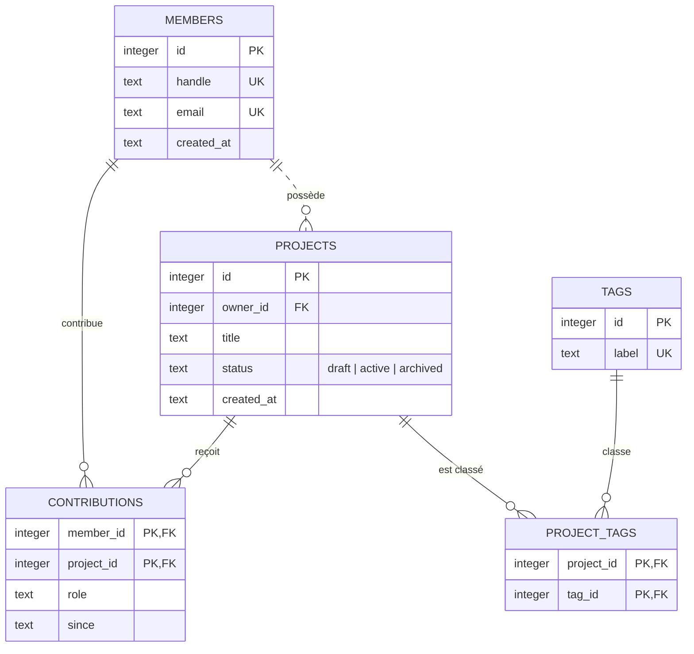

# 🗄️ Chapitre ORM : du SQL aux objets, et retour

## 📖 Vue d'ensemble

Un ORM (*Object-Relational Mapper*) promet de manipuler une base relationnelle comme si c'était un graphe d'objets. Cette promesse est utile et partiellement fausse : les deux modèles ne coïncident pas, et l'ORM ne fait que déplacer la frontière entre eux. Ce chapitre apprend à **voir cette frontière** : savoir ce que l'ORM fait à ta place, ce qu'il te cache, et quand il vaut mieux écrire le SQL toi-même.

Même principe que le chapitre `02_offline-first` : **comprendre le mécanisme sans framework avant d'utiliser l'abstraction**. Chaque module commence en SQL brut avec `node:sqlite` (intégré à Node, zéro dépendance), puis montre ce que font Prisma, Drizzle, Kysely, Knex, Sequelize, Doctrine ou Eloquent par-dessus.

### 🎯 Objectifs du chapitre

À la fin de ce chapitre, tu sauras :

- 🧩 **Expliquer** ce qu'est un ORM, le problème qu'il résout (*impedance mismatch*) et les patterns qui le composent
- ⚖️ **Choisir** entre SQL brut, query builder et ORM avec des critères explicites, pas par habitude
- 🧱 **Écrire, appliquer et annuler** des migrations, et savoir quand un rollback est une illusion
- 📐 **Passer** d'un MCD Merise à un ERD, à un diagramme de classes UML, à un schéma SQL, puis à un schéma d'ORM
- 📝 **Documenter** un modèle de données et sa couche d'accès de façon maintenable
- 🔬 **Diagnostiquer** les problèmes classiques : N+1, transactions mal isolées, mises à jour perdues, pagination lente

---

## 🧵 Le fil rouge : « l'Atelier »

Tous les modules utilisent le même domaine, pour que tu puisses comparer les approches sur des données identiques.

> Des **membres** portent des **projets**. Un membre peut **contribuer** à plusieurs projets avec un **rôle** (auteur, design, relecture…). Un projet est classé par **étiquettes**.



Ce petit schéma contient volontairement les trois formes d'association qui posent problème à tout ORM :

| Relation | Forme | Traduction relationnelle |
|---|---|---|
| Un membre possède des projets | 1-n | clé étrangère `projects.owner_id` |
| Un membre contribue à des projets **avec un rôle** | n-n porteuse d'attributs | table `contributions` avec ses propres colonnes |
| Un projet a des étiquettes | n-n pure | table de jointure `project_tags` |

Les fichiers sont dans [`fil-rouge/`](fil-rouge/) :

- [`schema.sql`](fil-rouge/schema.sql) : le schéma (SQLite, différences PostgreSQL en commentaire)
- [`seed.sql`](fil-rouge/seed.sql) : un jeu de données déterministe
- [`open-db.mjs`](fil-rouge/open-db.mjs) : ouvre une base en mémoire prête à l'emploi, avec un journal des requêtes optionnel

```javascript
// exemple.mjs (à placer dans fil-rouge/ ou à adapter le chemin)
import { openDb } from './open-db.mjs';

const db = openDb({ log: true });
const rows = db.prepare('SELECT handle FROM members ORDER BY handle').all();
console.log(rows, `${db.queries.length} requête(s)`);
```

```bash
node --disable-warning=ExperimentalWarning exemple.mjs
```

> `node:sqlite` est disponible sans option depuis Node 22.13 / 23.4. Il affiche un avertissement « experimental » : l'option ci-dessus le masque. L'API (`DatabaseSync`, `prepare`, `run`, `get`, `all`) est synchrone, ce qui garde les exemples lisibles. En production on utiliserait plutôt PostgreSQL avec un driver asynchrone (`pg`, `postgres`).

---

## 🗂️ Les 6 modules

Chaque module contient `notes.md` (le cours), `flashcards.md` (révision), `quiz.md` (évaluation) et `katas.md` (pratique, avec solutions).

### 1️⃣ [Fondamentaux](01-fondamentaux/notes.md) — *qu'est-ce qu'un ORM ?*
**Durée estimée :** 4-6 h

Le décalage objet/relationnel, ce qu'un ORM fait concrètement (mapping, génération de SQL, hydratation, suivi des changements), les patterns de Fowler (Table/Row Data Gateway, Active Record, Data Mapper), la cartographie des ORMs actuels, avantages et inconvénients argumentés.

**Kata phare :** écrire un mini Active Record, puis un mini Data Mapper, sur le même schéma.

---

### 2️⃣ [SQL brut, query builder, ORM](02-sql-query-builder-orm/notes.md) — *trois niveaux d'abstraction*
**Durée estimée :** 4-6 h

Le même besoin écrit trois fois. Critères de choix (contrôle, typage, sécurité, portabilité, performance, couplage), injection SQL et requêtes paramétrées, *tagged templates*, abstractions qui fuient, architectures hybrides.

**Kata phare :** écrire un query builder immuable qui produit `{ sql, params }`.

---

### 3️⃣ [Migrations](03-migrations/notes.md) — *versionner le schéma et revenir en arrière*
**Durée estimée :** 5-7 h

Anatomie d'une migration (`up`/`down`, table d'historique, ordre, checksum), migrations versionnées vs déclaratives, rollback outil par outil, DDL transactionnel selon le SGBD, migrations irréversibles, *roll-forward*, pattern *expand/contract* pour le zéro-downtime, migrations de données, seeds.

**Kata phare :** écrire un moteur de migrations complet (`up`, `down`, `status`) en Node natif.

---

### 4️⃣ [Modélisation : Merise, ERD, UML](04-modelisation-merise-uml-erd/notes.md) — *du concept au code*
**Durée estimée :** 6-8 h

Niveaux conceptuel / logique / physique, MCD → MLD → MPD, règles de passage, normalisation, notations ERD (Chen, crow's foot), diagramme de classes UML, le piège de l'inversion des cardinalités Merise/UML, héritage et ses trois stratégies de mapping, table de correspondance Merise ↔ ERD ↔ UML ↔ SQL ↔ ORM.

**Kata phare :** d'un cahier des charges en texte jusqu'au schéma Prisma, en passant par chaque niveau.

---

### 5️⃣ [Documenter un ORM](05-documenter/notes.md) — *rendre le modèle lisible et durable*
**Durée estimée :** 3-4 h

Quoi documenter (le modèle, le mapping, les comportements cachés, l'évolution, l'exploitation), où (au plus près de la source de vérité), comment (commentaires SQL, `///` Prisma, dictionnaire de données, ERD généré, ADR, en-têtes de migration, runbook de rollback), cadre Diátaxis.

**Kata phare :** générer automatiquement un dictionnaire de données et un ERD Mermaid par introspection de la base.

---

### 6️⃣ [Concepts avancés](06-concepts-avances/notes.md) — *ce qui casse en production*
**Durée estimée :** 8-10 h

Problème N+1 et stratégies de chargement, Identity Map et Unit of Work, transactions et niveaux d'isolation, verrouillage optimiste/pessimiste, pagination par curseur, index et plans d'exécution, soft delete, pool de connexions, hooks et effets de bord, *mass assignment*, multi-tenant, tests, CQRS léger, approche SQL-first.

**Kata phare :** reproduire un N+1 avec le journal de requêtes, puis le corriger par chargement groupé.

---

## 📚 Progression recommandée

```
01 Fondamentaux ──► 02 SQL / QB / ORM ──► 03 Migrations
        │                                      │
        └──► 04 Modélisation ──────────────────┤
                                               ▼
                         05 Documenter ──► 06 Concepts avancés
```

- Le module 04 peut se lire en parallèle des modules 02-03 : il ne dépend que du 01.
- Le module 06 suppose les modules 01 à 03 acquis.

### Prérequis

- JavaScript moderne : modules ES, classes, `async/await` (chapitre `01_programming-basics`)
- SQL de base : `SELECT`, `WHERE`, `JOIN`, `GROUP BY`, `INSERT`, `UPDATE`, `DELETE`. Si un `JOIN` te pose problème, commence par là : un ORM ne remplace pas cette compétence, il la suppose.

---

## 📊 Critères de réussite

Tu as acquis ce chapitre quand tu peux, sans notes :

- [ ] Expliquer l'*impedance mismatch* avec au moins trois de ses dimensions
- [ ] Distinguer Active Record et Data Mapper, et citer un ORM de chaque famille
- [ ] Justifier le choix SQL brut / query builder / ORM pour un projet donné
- [ ] Écrire une migration réversible, l'appliquer, l'annuler, et dire quand le `down` perd des données
- [ ] Décrire les étapes *expand/contract* pour renommer une colonne sans interruption de service
- [ ] Traduire un MCD en MLD puis en SQL, sans inverser les cardinalités
- [ ] Repérer un N+1 dans un journal de requêtes et le corriger
- [ ] Expliquer une mise à jour perdue et deux façons de l'empêcher

---

## 🔗 Références

Des sources primaires et des auteurs rigoureux, plutôt que des tutoriels.

### Fondations
- **E. F. Codd**, « A Relational Model of Data for Large Shared Data Banks », *Communications of the ACM*, 1970. L'article qui fonde le modèle relationnel.
- **Peter Chen**, « The Entity-Relationship Model — Toward a Unified View of Data », *ACM TODS*, 1976. L'origine des ERD.
- **H. Tardieu, A. Rochfeld, R. Colletti**, *La méthode Merise*, tome 1, Éditions d'Organisation, 1983.
- **C. J. Date**, *Database Design and Relational Theory*, O'Reilly, 2012 (2ᵉ éd. Apress 2019). Normalisation traitée avec rigueur.

### ORM et architecture
- **Martin Fowler**, *Patterns of Enterprise Application Architecture*, Addison-Wesley, 2002. Le vocabulaire de référence : Active Record, Data Mapper, Unit of Work, Identity Map, Lazy Load.
- **Ted Neward**, « The Vietnam of Computer Science », 2006. La critique fondatrice de l'ORM.
- **Martin Fowler**, « OrmHate », bliki, 2012. La réponse nuancée.
- **Eric Evans**, *Domain-Driven Design*, Addison-Wesley, 2003. Agrégats et repositories.
- **M. Stonebraker, A. Pavlo**, « What Goes Around Comes Around… And Around… », *SIGMOD Record*, 2024. Pourquoi le relationnel revient toujours.

### Migrations et évolution
- **S. Ambler, P. Sadalage**, *Refactoring Databases: Evolutionary Database Design*, Addison-Wesley, 2006.
- **P. Sadalage, M. Fowler**, « Evolutionary Database Design », martinfowler.com (2003, révisé en 2016).

### Performance et transactions
- **Markus Winand**, *SQL Performance Explained*, 2012, et [use-the-index-luke.com](https://use-the-index-luke.com/).
- **Martin Kleppmann**, *Designing Data-Intensive Applications*, O'Reilly, 2017. Chapitres 2 (modèles de données) et 7 (transactions).
- **H. Berenson et al.**, « A Critique of ANSI SQL Isolation Levels », *SIGMOD*, 1995.

### Documentation
- **Michael Nygard**, « Documenting Architecture Decisions », 2011. L'origine des ADR.
- **Daniele Procida**, [Diátaxis](https://diataxis.fr/). Un cadre pour structurer une documentation technique.

---

*Durée totale estimée : 30-40 heures, soit 4 à 6 semaines à 8 h/semaine.*
